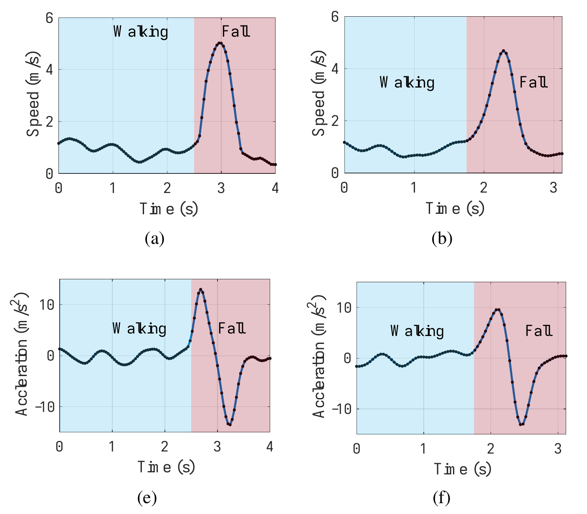
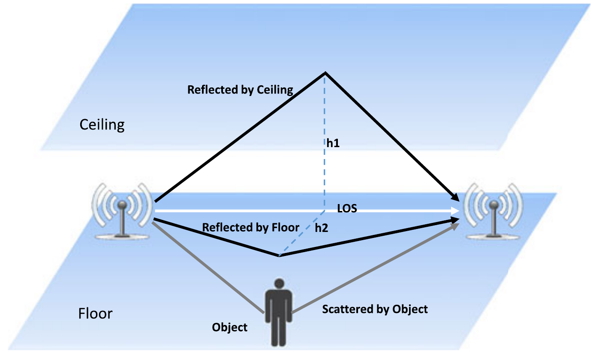
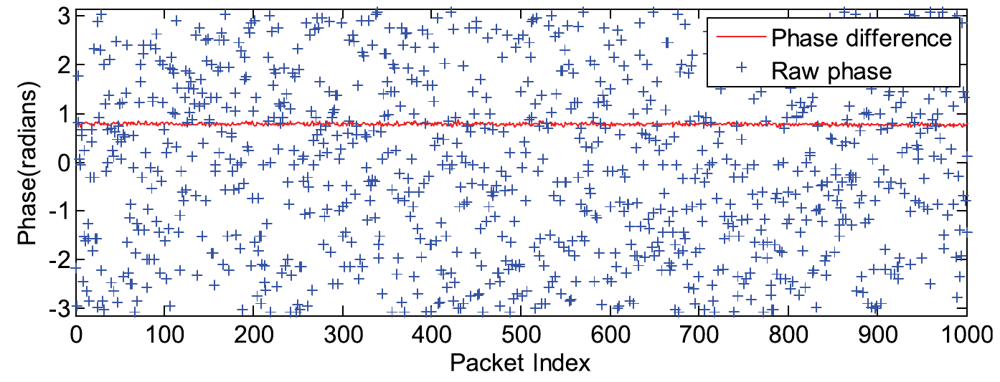
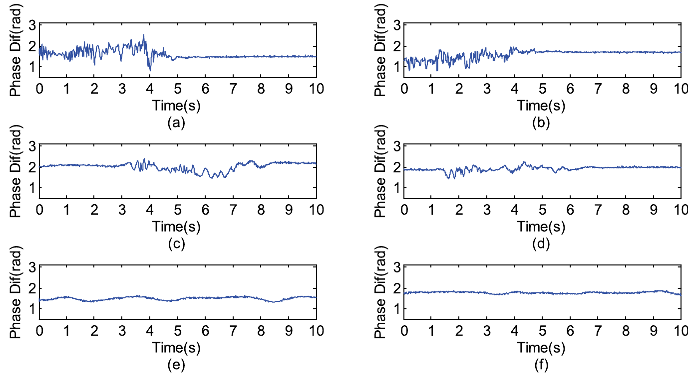

# 2. Landasan Kepustakaan

Gerakan tubuh mengubah kanal Wi-Fi yang dilalui sinyal. Perubahan ini menjadi dasar deteksi jatuh berbasis *channel state information* (CSI), meskipun pengukuran juga dipengaruhi ruangan dan perangkat. Bab ini menguraikan hubungan tersebut, mulai dari karakteristik jatuh hingga pengolahan CSI dan evaluasi deteksi. Fokusnya adalah perubahan fase relatif terhadap waktu, dengan perubahan amplitudo sebagai pembanding.

## 2.1. Jatuh sebagai Objek Deteksi

### 2.1.1. Definisi Jatuh

Menurut World Health Organization, jatuh adalah kejadian yang membuat seseorang tanpa sengaja berada di tanah, lantai, atau permukaan yang lebih rendah [@worldhealthorganizationFalls2021]. Ketidaksengajaan menjadi unsur penting dalam definisi ini. Seseorang yang berbaring dengan sengaja juga menurunkan posisi tubuh, tetapi gerakan tersebut tidak termasuk jatuh.

Penelitian ini menggunakan transisi tubuh akibat kehilangan kendali atau keseimbangan menuju lantai atau permukaan pengaman sebagai definisi operasional jatuh. Duduk, berjongkok, dan berbaring secara terkendali dimasukkan ke kelas non-jatuh. Pada data peragaan, label jatuh menunjukkan simulasi gerakan tersebut. Batas waktu kejadian dan aturan anotasinya dijelaskan dalam Bab Metodologi.

### 2.1.2. Dampak Kejadian Jatuh

Cedera akibat jatuh dapat berupa memar, patah tulang, atau trauma kepala. Korban juga dapat memerlukan perawatan jangka panjang [@worldhealthorganizationFalls2021]. Kesulitan lain muncul ketika korban tidak mampu bangkit. Dalam keadaan ini, korban harus menunggu bantuan untuk dapat beranjak dari lantai.

Keadaan tidak mampu bangkit dari lantai selama lebih dari satu jam setelah jatuh disebut *long lie*. Blackburn dkk. meninjau dampak fisik dan klinis keadaan ini pada lansia. Bukti yang mereka temukan masih terbatas, terutama untuk dampak jangka panjang. Studi yang ditinjau berbeda dalam populasi dan cara pengukurannya, serta bergantung pada ingatan pasien [@blackburnExploringImpactExperiencing2022]. Keterbatasan tersebut membuat hubungan sebab-akibat antara *long lie* dan memburuknya kesehatan belum dapat dipastikan.

Detektor otomatis dapat mengirim peringatan saat korban tidak mampu meminta bantuan. Igual dkk. menyebut pemberian bantuan dan pengurangan waktu di lantai sebagai manfaat potensial sistem deteksi jatuh [@igualChallengesIssuesTrends2013]. Peringatan itu masih harus diterima dan ditindaklanjuti oleh penolong. Dengan demikian, waktu deteksi dan waktu kedatangan bantuan merupakan dua hal yang berbeda.

### 2.1.3. Karakteristik Gerakan Jatuh

Becker dkk. membagi jatuh ke dalam lima fase: sebelum jatuh, gerakan jatuh, benturan, istirahat, dan pemulihan [@beckerProposalMultiphaseFall2012]. Pembagian ini membantu menjelaskan urutan kejadian pada rekaman, dari kondisi awal hingga gerakan setelah benturan. Durasi dan kejelasan setiap fase dapat berbeda antarkejadian.

DeFall memodelkan jatuh melalui peningkatan kecepatan saat tubuh turun dan perlambatan saat mencapai permukaan. Urutan kecepatan dan percepatan ini dipakai untuk membedakan jatuh dari aktivitas lain [@huDeFallEnvironmentIndependentPassive2022]. Polanya dapat berubah ketika seseorang menahan tubuh pada furnitur, jatuh dari kursi, atau menggerakkan anggota badan dengan cara berbeda, sebagaimana dibahas dalam FallDar [@yangRethinkingFallDetection2023]. Karena itu, deteksi perlu memperhatikan rangkaian gerak, bukan hanya satu lonjakan sinyal.

Gambar 2.1 memperlihatkan contoh hasil estimasi DeFall untuk aktivitas berjalan yang diikuti jatuh. Panel (a) dan (b) menunjukkan kecepatan, sedangkan panel (e) dan (f) menunjukkan percepatan. Kolom kiri berasal dari kondisi garis pandang langsung atau line-of-sight (LOS), dan kolom kanan dari kondisi non-line-of-sight (NLOS). Pada contoh ini, peningkatan kecepatan selama jatuh diikuti perlambatan saat gerakan berakhir.

::: {custom-style="FigureImage"}
{width=11.5cm}
:::

::: {custom-style="FigureCaption"}
**Gambar 2.1 Pola kecepatan dan percepatan berjalan lalu jatuh pada kondisi LOS dan NLOS.**
:::

::: {custom-style="FigureSource"}
Sumber: Hu dkk. [-@huDeFallEnvironmentIndependentPassive2022], Gambar 7, panel (a), (b), (e), dan (f).
:::

### 2.1.4. Aktivitas Non-Jatuh yang Menyerupai Jatuh

Beberapa aktivitas sehari-hari (*activities of daily living*, ADL) memiliki bagian gerak yang mirip dengan jatuh. Duduk dan berbaring, misalnya, sama-sama dapat diikuti keadaan yang relatif diam. RT-Fall membahas kemiripan tersebut, sedangkan FallDeFi menguji aktivitas pembanding berupa membungkuk untuk mengambil benda, melompat, duduk, dan berdiri [@wangRTFallRealTimeContactless2017; @palipanaFallDeFiUbiquitousFall2017]. Perubahan posisi yang cepat pada aktivitas ini menjadi tantangan bagi detektor.

Pengujian terhadap keadaan diam saja belum cukup untuk menilai kemampuan detektor membedakan gerakan. Duduk cepat dan berbaring sengaja perlu dipertimbangkan sebagai aktivitas pembanding. Berjongkok dan berlutut juga menurunkan posisi tubuh, sehingga relevan untuk menguji batas deteksi. Apakah gerakan-gerakan ini memicu alarm palsu perlu diperiksa melalui data penelitian.

## 2.2. Sistem Deteksi Jatuh

### 2.2.1. Sistem Berbasis Perangkat *Wearable*

Perangkat *wearable* mengukur gerak melalui sensor yang dikenakan pada tubuh. Akselerometer mengukur percepatan, sedangkan giroskop mengukur perubahan orientasi. Pengamatan tidak dibatasi cakupan sensor ruangan, tetapi bergantung pada pemakaian dan posisi perangkat. Igual dkk. mengingatkan bahwa posisi sensor yang diseragamkan dalam eksperimen belum tentu sesuai dengan cara pengguna membawa perangkat sehari-hari [@igualChallengesIssuesTrends2013].

### 2.2.2. Sistem Berbasis Kamera

Kamera menyediakan informasi bentuk tubuh, postur, dan perubahan posisi dalam rangkaian citra. Informasi ini membantu pengenalan jatuh, tetapi tubuh dapat tertutup oleh furnitur atau objek lain. Kamera biasa juga bergantung pada pencahayaan; kamera inframerah dan kedalaman memiliki karakteristik berbeda. Pembahasan RT-Fall tentang pendekatan visual mencakup penggunaan kamera kedalaman, keterbatasan cakupan pandang, dan persoalan privasi [@wangRTFallRealTimeContactless2017].

### 2.2.3. Sistem Berbasis Gelombang Radio

Pada sistem berbasis radio, gerakan manusia dikenali dari perubahan sinyal yang diterima perangkat di lingkungan. Pengguna tidak perlu mengenakan sensor. WiFall menerapkan cara ini dengan membaca CSI dari perangkat Wi-Fi komoditas [@wangWiFallDeviceFreeFall2017]. Cakupan pengamatannya dipengaruhi posisi perangkat, penghalang, dan lintasan yang dilalui sinyal di dalam ruangan.

### 2.2.4. Perbandingan Pendekatan Deteksi Jatuh

Tabel 2.1 membandingkan kebutuhan penggunaan dan informasi yang diperoleh dari ketiga pendekatan [@igualChallengesIssuesTrends2013; @wangRTFallRealTimeContactless2017]. Akurasi tidak diperingkatkan karena perangkat, data, dan kondisi pengujian masing-masing pendekatan berbeda.

Tabel 2.1. Perbandingan pendekatan deteksi jatuh.

| Aspek | *Wearable* | Kamera | Wi-Fi CSI |
| --- | --- | --- | --- |
| Perangkat pada tubuh | Diperlukan | Tidak diperlukan | Tidak diperlukan |
| Pencahayaan | Bukan dasar pengukuran inersial | Berpengaruh pada kamera biasa; berbeda untuk inframerah/kedalaman | Bukan dasar pengukuran kanal |
| Informasi utama | Percepatan/orientasi lokal tubuh | Bentuk, postur, dan gerak visual | Perubahan respons kanal |
| Pengaruh lingkungan/penggunaan | Posisi, kepatuhan pemakaian, dan daya perangkat | Oklusi dan cakupan pandang | *Multipath*, penghalang, dan tata letak perangkat |
| Privasi | Merekam gerak pemakai | Dapat merekam citra dan identitas | Tidak merekam citra, tetapi dapat mengungkap aktivitas |

Penelitian ini menggunakan Wi-Fi untuk menguji informasi gerak dalam kanal komunikasi. WiFall dan FallDeFi menunjukkan bahwa CSI dapat diperoleh dari perangkat tertentu yang mendukung ekstraksinya [@wangWiFallDeviceFreeFall2017; @palipanaFallDeFiUbiquitousFall2017]. Akses tersebut perlu dipastikan pada perangkat yang digunakan. Dari sisi privasi, Wi-Fi tidak merekam citra, tetapi sinyalnya dapat mengungkap aktivitas. Windl dkk. menunjukkan bahwa persepsi privasi pengindraan radio bergantung pada konteks penggunaan dan informasi yang dapat disimpulkan dari sensor [@windlPrivacySolutionMenace2025].

## 2.3. Pengindraan Manusia Berbasis Gelombang Radio

### 2.3.1. Prinsip *Device-Free Sensing*

Dalam *device-free sensing*, orang yang diamati tidak perlu membawa perangkat pengindraan. Sistem tetap menggunakan pemancar dan penerima. Sinyal dari pemancar berinteraksi dengan lingkungan sebelum mencapai penerima; kehadiran dan gerakan tubuh mengubah sebagian lintasannya. Perubahan pengukuran inilah yang digunakan untuk mengenali aktivitas [@liuWirelessSensingHuman2020].

### 2.3.2. Interaksi Gelombang Radio dengan Tubuh dan Lingkungan

Gelombang radio dapat dipantulkan oleh permukaan, dihamburkan ke berbagai arah, atau mengalami difraksi di sekitar tepi penghalang. WiFall membahas ketiga mekanisme tersebut melalui kontribusi lintasan langsung, lantai, plafon, dan tubuh terhadap respons kanal [@wangWiFallDeviceFreeFall2017]. Sebagian energi juga diserap material. Dalam model kanal efektif, pelemahan ini tercakup dalam koefisien lintasan.

Gambar 2.2 menunjukkan lintasan langsung, pantulan dari plafon dan lantai, serta hamburan oleh tubuh pada model WiFall. Penerima menangkap gabungan lintasan tersebut. Gerakan tubuh mengubah sebagian kontribusinya, sementara pantulan dari permukaan ruangan tetap ikut membentuk respons kanal.

::: {custom-style="FigureImage"}
{width=12cm}
:::

::: {custom-style="FigureCaption"}
**Gambar 2.2 Lintasan propagasi Wi-Fi di dalam ruangan.**
:::

::: {custom-style="FigureSource"}
Sumber: Wang dkk. [-@wangWiFallDeviceFreeFall2017], Gambar 1.
:::

Gerakan tubuh mengubah geometri lintasan dan permukaan yang berinteraksi dengan gelombang. Penerima dapat menangkap perubahan akibat perpindahan, perubahan orientasi tubuh, maupun pergeseran objek di ruangan. Detektor perlu membedakan pola-pola tersebut agar gangguan kanal dari aktivitas lain tidak dikenali sebagai jatuh.

### 2.3.3. Propagasi *Multipath*

Di dalam ruangan, penerima mengamati superposisi beberapa lintasan propagasi atau *multipath*. Dengan menyederhanakan model kanal yang digunakan FallDar, respons pada frekuensi subcarrier $f_k$ dapat ditulis sebagai

$$
H_k(t)=\sum_{\ell=1}^{L}\alpha_\ell(t)e^{-j2\pi f_k\tau_\ell(t)},
$$

dengan $L$ sebagai jumlah lintasan, $\alpha_\ell(t)$ sebagai koefisien kompleks lintasan, dan $\tau_\ell(t)$ sebagai waktu tundanya [@yangRethinkingFallDetection2023]. Perubahan panjang lintasan mengubah waktu tunda dan fase. Karena komponen tersebut dijumlahkan secara kompleks, kontribusi antarlintasan dapat saling memperkuat atau melemahkan.

Gerakan yang sama dapat menghasilkan amplitudo dan fase berbeda di lokasi lain. Pantulan dari dinding dan furnitur membentuk kondisi awal kanal, lalu gerakan tubuh mengubah sebagian lintasannya. Model yang dilatih langsung dari pengukuran CSI dapat ikut mempelajari ciri ruangan tempat data dikumpulkan [@yangRethinkingFallDetection2023]. Hal ini menjelaskan mengapa pemindahan lingkungan menjadi persoalan dalam deteksi berbasis CSI.

### 2.3.4. Faktor yang Memengaruhi Pengindraan Radio

Kepekaan pengindraan bergantung pada posisi dan orientasi tubuh, jarak perangkat, serta penghalang di ruangan. Pada WiFall, kinerja berubah menurut lokasi, tinggi tautan, dan kondisi tautan yang terhalang. RT-Fall juga melaporkan perubahan hasil setelah furnitur besar dipindahkan [@wangWiFallDeviceFreeFall2017; @wangRTFallRealTimeContactless2017].

Bentuk gerak berbeda antarsubjek. Gerakan orang atau objek lain juga dapat menambah perubahan kanal yang diterima sensor. FallDar membahas variasi lingkungan, gerakan, dan pengguna sebagai tiga persoalan deteksi [@yangRethinkingFallDetection2023]. Pengulangan oleh satu orang di lokasi yang sama belum mewakili ketiga variasi tersebut.

## 2.4. Wi-Fi, OFDM, dan *Channel State Information*

### 2.4.1. Dasar Komunikasi Wi-Fi

Penerima Wi-Fi memperkirakan pelemahan dan perubahan fase sinyal untuk memulihkan informasi yang dikirim. Estimasi kanal ini juga dapat digunakan untuk mengamati perubahan lingkungan. WiFall memanfaatkannya sebagai masukan deteksi jatuh [@wangWiFallDeviceFreeFall2017]. Dasar komunikasi yang dibahas di sini berfokus pada pembentukan estimasi tersebut.

### 2.4.2. *Orthogonal Frequency-Division Multiplexing*

*Orthogonal frequency-division multiplexing* (OFDM) membagi transmisi ke sejumlah subcarrier ortogonal. Estimasi respons pada masing-masing subcarrier memperlihatkan variasi kanal terhadap frekuensi. Menurut FallDeFi, informasi ini lebih terperinci daripada RSSI yang menyatakan kekuatan sinyal secara agregat [@palipanaFallDeFiUbiquitousFall2017]. Jumlah subcarrier yang dapat dibaca sebagai CSI bergantung pada perangkat dan alat ekstraksinya.

### 2.4.3. Respons Kanal

Untuk satu pasangan antena pada subcarrier ke-$k$, hubungan sinyal dapat dinyatakan sebagai

$$
Y_k(t)=H_k(t)X_k(t)+N_k(t),
$$

dengan $X_k(t)$ sebagai sinyal yang dikirim, $Y_k(t)$ sebagai sinyal yang diterima, $H_k(t)$ sebagai respons kanal kompleks, dan $N_k(t)$ sebagai derau. Bentuk ini merupakan penyederhanaan per-subcarrier dari model hubungan masukan–keluaran kanal pada WiFall [@wangWiFallDeviceFreeFall2017]. Pada konfigurasi beberapa antena, respons kanal diperluas menjadi matriks yang menghubungkan antena pemancar dan penerima. Pengukuran CSI merupakan estimasi respons tersebut, sehingga dapat mengandung galat dan bukan nilai kanal ideal yang diketahui secara tepat.

### 2.4.4. *Channel State Information*

CSI merepresentasikan estimasi karakteristik kanal pada subcarrier dan pasangan antena tertentu. Setiap nilainya mempunyai amplitudo dan fase, yang dapat ditulis sebagai

$$
H_k(t)=|H_k(t)|e^{j\phi_k(t)},
$$

dengan $|H_k(t)|$ sebagai amplitudo, $\phi_k(t)$ sebagai fase, dan $j=\sqrt{-1}$. Representasi kompleks ini mempertahankan informasi pelemahan dan pergeseran fase kanal [@liuWirelessSensingHuman2020]. Untuk menyederhanakan notasi, $H$ selanjutnya digunakan bagi CSI terukur apabila tidak sedang dibedakan dari kanal ideal.

Pengukuran berulang menghasilkan data dengan dimensi waktu, subcarrier, antena pemancar, dan antena penerima. WiFall membaca beberapa aliran antena dan subcarrier pada setiap paket [@wangWiFallDeviceFreeFall2017]. Susunan dimensi ini perlu dijaga selama pengolahan agar perhitungan selisih selalu memakai komponen yang bersesuaian.

## 2.5. Amplitudo dan Fase CSI

### 2.5.1. Amplitudo CSI

Amplitudo CSI menyatakan magnitudo respons kanal kompleks. Nilainya berasal dari gabungan lintasan yang mencapai penerima. Saat tubuh bergerak, perubahan fase antarlintasan dapat memperkuat atau melemahkan resultan sinyal. WiFall menggunakan variasi amplitudo ini untuk mengenali aktivitas dan melakukan klasifikasi [@wangWiFallDeviceFreeFall2017].

Perubahan amplitudo tidak mempunyai hubungan sederhana dengan kecepatan atau jarak perpindahan tubuh. Aktivitas berbeda dapat menghasilkan fluktuasi serupa, sementara satu aktivitas dapat menghasilkan fluktuasi berbeda ketika posisinya berubah. RT-Fall membahas keterbatasan amplitudo dalam memisahkan aktivitas yang berlangsung berkesinambungan [@wangRTFallRealTimeContactless2017].

### 2.5.2. Fase CSI

Fase CSI menyatakan sudut respons kanal kompleks. Untuk satu lintasan ideal dengan panjang $d$, komponen fase propagasinya mengikuti $-2\pi d/\lambda$ modulo $2\pi$, dengan $\lambda$ sebagai panjang gelombang. Hubungan ini mengikuti faktor waktu tunda pada model kanal di Bagian 2.3.3. Pada *multipath*, fase CSI adalah sudut jumlah seluruh komponen, sehingga tidak dapat langsung dikonversi menjadi satu jarak tubuh [@yangRethinkingFallDetection2023].

Fase dapat memperlihatkan perubahan yang kurang jelas pada amplitudo, tetapi fase terukur juga dipengaruhi ketidaksinkronan perangkat. RT-Fall mengatasi sebagian gangguan ini dengan menggunakan selisih fase dua antena. Pada konfigurasi yang diuji, selisih fase memberikan indikator aktivitas yang lebih peka daripada amplitudo [@wangRTFallRealTimeContactless2017].

### 2.5.3. Perbandingan Informasi Amplitudo dan Fase

Amplitudo menunjukkan besar resultan kanal, sedangkan fase menunjukkan sudutnya. Keduanya berasal dari pengukuran kompleks yang sama, tetapi dapat menonjolkan perubahan yang berbeda. RT-Fall melaporkan kepekaan selisih fase terhadap aktivitas, sementara FallDar menunjukkan bahwa informasi fase masih dipengaruhi lingkungan [@wangRTFallRealTimeContactless2017; @yangRethinkingFallDetection2023]. Kepekaan tersebut perlu diuji lebih lanjut melalui kemampuan klasifikasi pada kondisi yang berbeda.

Amplitudo dipilih sebagai pembanding karena telah digunakan untuk deteksi jatuh pada WiFall dan FallDeFi [@wangWiFallDeviceFreeFall2017; @palipanaFallDeFiUbiquitousFall2017]. Dalam penelitian ini, perubahan amplitudo dan fase relatif dihitung dari rekaman yang sama. Perbandingan keduanya digunakan untuk menilai informasi yang lebih membantu pengenalan jatuh pada kondisi pengujian.

## 2.6. Fase Relatif CSI

### 2.6.1. Keterbatasan Fase Mentah CSI

Fase mentah memuat respons kanal dan galat pengukuran. Ketidaksinkronan pemancar–penerima, perbedaan waktu pencuplikan, dan offset perangkat keras dapat mengubah fase tanpa adanya gerakan tubuh. Pada Intel 5300 yang digunakan RT-Fall, nilai fase mentah tersebar tidak stabil. Peneliti kemudian menghitung selisih fase antarantena untuk mengurangi komponen gangguan yang dialami bersama [@wangRTFallRealTimeContactless2017].

Pada Gambar 2.3, fase mentah tersebar lebar meskipun tidak ada manusia di area pengamatan. Selisih fase antarantena tampak lebih stabil. Hasil eksperimen RT-Fall ini memperlihatkan alasan penggunaan selisih fase untuk mengurangi gangguan bersama pada perangkat yang diuji.

::: {custom-style="FigureImage"}
{width=13.5cm}
:::

::: {custom-style="FigureCaption"}
**Gambar 2.3 Fase mentah dan selisih fase CSI pada kondisi tanpa kehadiran manusia.**
:::

::: {custom-style="FigureSource"}
Sumber: Wang dkk. [-@wangRTFallRealTimeContactless2017], Gambar 5.
:::

### 2.6.2. Pembentukan Fase Relatif

Untuk dua antena penerima $a$ dan $b$, fase relatif didefinisikan sebagai

$$
\Delta\phi_k(t)=\phi_{k,a}(t)-\phi_{k,b}(t).
$$

Pengurangan dilakukan pada subcarrier, paket, dan antena pemancar yang sama. Apabila kedua rantai penerima mengalami komponen galat fase bersama, komponen tersebut dapat saling menghilangkan dalam pengurangan. RT-Fall menggunakan satu antena pemancar dan dua antena penerima pada perangkat yang sama untuk memanfaatkan sifat tersebut [@wangRTFallRealTimeContactless2017].

Galat yang berbeda antarantena tetap dapat tersisa setelah pengurangan, termasuk offset, derau, dan ketidakcocokan waktu. Dua perangkat penerima yang tidak tersinkronisasi belum tentu memiliki komponen galat bersama seperti antena pada satu perangkat. Konfigurasi penerima karena itu menentukan apakah pengurangan fase dapat diterapkan dengan asumsi tersebut.

Bentuk ekuivalen yang langsung menggunakan CSI kompleks adalah

$$
\theta_k(t)=\arg\left(H_{k,a}(t)H_{k,b}^{*}(t)\right),
$$

dengan tanda $*$ sebagai konjugat kompleks. Identitas ini menghasilkan selisih fase terbungkus pada interval utama, misalnya $(-\pi,\pi]$. Nilai $\theta_k$ dan $\Delta\phi_k$ menyatakan besaran sudut yang sama modulo $2\pi$; keduanya tidak selalu sama sebagai bilangan real tanpa penanganan pembungkusan.

### 2.6.3. Perubahan Temporal Fase Relatif

Deret waktu fase relatif memperlihatkan perubahan kanal selama aktivitas berlangsung. RT-Fall menggunakan variabilitas selisih fase untuk menentukan segmen aktivitas dan informasi waktu–frekuensi untuk membedakan jenis transisinya. Duduk dan berbaring juga dapat diikuti keadaan yang lebih stabil, sehingga segmen yang ditemukan masih memerlukan klasifikasi [@wangRTFallRealTimeContactless2017].

Gambar 2.4 membandingkan selisih fase CSI untuk berjalan lalu jatuh pada panel (a)–(b), duduk pada panel (c)–(d), dan berdiri pada panel (e)–(f). Kolom kiri menunjukkan kondisi LOS, sedangkan kolom kanan menunjukkan kondisi NLOS. Pada contoh jatuh, fluktuasi fase beralih menuju keadaan yang lebih stabil. Namun, perubahan menuju keadaan stabil juga terlihat pada aktivitas duduk, sehingga pola transisi saja belum cukup untuk menentukan kelas jatuh.

::: {custom-style="FigureImage"}
{width=12.5cm}
:::

::: {custom-style="FigureCaption"}
**Gambar 2.4 Selisih fase CSI saat jatuh, duduk, dan berdiri dalam kondisi LOS dan NLOS.**
:::

::: {custom-style="FigureSource"}
Sumber: Wang dkk. [-@wangRTFallRealTimeContactless2017], Gambar 7.
:::

Dalam penelitian ini, perubahan temporal dapat direpresentasikan melalui beda sudut sirkular antarsampel,

$$
D_{\phi,k}[n]=\arg\left(e^{j(\theta_k[n]-\theta_k[n-1])}\right).
$$

Bentuk ini menghindari lonjakan semu akibat perpindahan dari $\pi$ ke $-\pi$ pada dua sudut yang sebenarnya berdekatan. Nilainya menyatakan perubahan sudut, bukan kecepatan tubuh. Jika dinyatakan sebagai laju perubahan, selisih tersebut perlu dibagi selang waktu aktual antarsampel. Pilihan antara beda sirkular dan beda fase setelah *unwrapping* merupakan keputusan pengolahan yang harus ditetapkan dalam metodologi.

Perubahan temporal fase relatif dipilih untuk mengurangi gangguan bersama antarantena sekaligus mempertahankan perubahan kanal dari waktu ke waktu. Temuan RT-Fall menjadi dasar dugaan bahwa representasi ini memuat informasi jatuh. Kemampuannya pada perangkat dan data penelitian ini masih perlu diuji.

### 2.6.4. Keterbatasan Fase Relatif

Geometri antena dan lintasan ke setiap antena tetap memengaruhi fase relatif. Pergeseran perangkat atau posisi tubuh dapat mengubah polanya. FallDar menunjukkan bahwa selisih fase masih sensitif terhadap lingkungan [@yangRethinkingFallDetection2023]. Fase juga mudah terganggu derau ketika magnitudo sinyal sangat kecil.

Beda sudut utama tidak cukup untuk memulihkan perubahan yang melampaui setengah putaran antarsampel tanpa asumsi tambahan. Proses *unwrapping* bergantung pada kesinambungan fase, sehingga celah data yang panjang dapat menimbulkan kesalahan. Pemeriksaan urutan waktu, paket hilang, dan amplitudo diperlukan sebelum perubahan fase ditafsirkan.

## 2.7. Pengolahan dan Representasi CSI

### 2.7.1. Prapemrosesan CSI

Prapemrosesan mengurangi gangguan pengukuran sambil menjaga perubahan sinyal akibat aktivitas. Teknik yang digunakan berbeda antarsistem: RT-Fall memakai interpolasi dan penyaringan pita, WiFall memakai perataan berbobot, sedangkan FallDeFi memakai *wavelet* dan analisis komponen utama (PCA) [@wangRTFallRealTimeContactless2017; @wangWiFallDeviceFreeFall2017; @palipanaFallDeFiUbiquitousFall2017]. Pemilihannya mengikuti sifat data dan representasi yang akan digunakan.

Pengolahan dalam penelitian ini mempertimbangkan paket hilang, urutan waktu, pencilan, derau, dan pemilihan subcarrier. Interpolasi pada celah panjang dapat membentuk pola yang tidak terekam, sehingga celah tersebut perlu ditandai. Perubahan cepat juga perlu diperiksa sebelum dihapus sebagai pencilan karena dapat berasal dari gerakan jatuh. Pengolahan fase memperhitungkan sifat sudutnya. Parameter normalisasi atau pemilihan komponen yang dipelajari dari data ditentukan hanya dari data pelatihan.

### 2.7.2. Segmentasi dan Pembentukan *Window*

Segmentasi mengambil bagian rekaman untuk dijadikan masukan model. RT-Fall menentukan akhir kandidat aktivitas lalu mengambil segmen di sekitarnya. FallDar menggunakan *window* yang bergeser untuk memproses aliran sinyal [@wangRTFallRealTimeContactless2017; @yangRethinkingFallDetection2023]. Ukuran segmen menentukan seberapa banyak gerakan sebelum, selama, dan setelah transisi yang dapat diamati model.

*Window* pendek berisiko memotong transisi jatuh. Sebaliknya, jendela panjang dapat mencakup aktivitas lain dan menambah waktu tunggu deteksi. Jendela yang tumpang tindih juga berbagi sampel, sehingga beberapa masukan dapat berasal dari kejadian yang sama. Pemisahan data berdasarkan kejadian atau rekaman diperlukan agar potongan gerakan yang sama tidak masuk ke data pelatihan dan pengujian sekaligus.

### 2.7.3. Representasi Fase Relatif

Data fase relatif disusun menurut waktu, subcarrier, dan pasangan antena penerima, dengan antena pemancar yang tetap teridentifikasi. Perubahan temporal pada Bagian 2.6.3 dapat digunakan sebagai deret waktu atau diringkas menjadi fitur. Deret waktu mempertahankan urutan perubahan; fitur merangkum besar perubahan, penyebaran, atau durasinya. Pilihan bentuk masukan mengikuti kebutuhan model yang akan diuji.

Pasangan antena harus konsisten sepanjang pengolahan. Pembalikan urutan $a$ dan $b$ mengubah tanda selisih fase sehingga pencampuran urutan dapat mengubah makna masukan. Penggabungan subcarrier juga perlu mempertahankan sifat sirkular fase; rata-rata sudut biasa dapat keliru ketika nilai berada dekat batas pembungkusan.

### 2.7.4. Representasi Perubahan Amplitudo

Dengan $A_{k,a}[n]=|H_{k,a}[n]|$, perubahan amplitudo dapat dibentuk sebagai

$$
D_{A,k,a}[n]=A_{k,a}[n]-A_{k,a}[n-1].
$$

Beda amplitudo tersebut didefinisikan sebagai representasi pembanding dalam penelitian ini. WiFall dan FallDeFi mendukung penggunaan informasi amplitudo untuk deteksi jatuh, meskipun bentuk pengolahannya berbeda [@wangWiFallDeviceFreeFall2017; @palipanaFallDeFiUbiquitousFall2017]. Amplitudo diambil dari antena yang juga digunakan untuk fase relatif. Nilainya dapat dipertahankan sebagai kanal terpisah atau digabung menurut aturan pengolahan yang ditetapkan.

Kedua representasi dibandingkan dengan kejadian, label, pembagian data, dan kesempatan penyetelan model yang sama. Operasi pengolahannya dapat berbeda sesuai sifat besaran. Fase memerlukan penanganan sudut, sedangkan amplitudo dapat memerlukan normalisasi skala. Perbedaan ini dicatat agar hasil perbandingan dapat ditelusuri ke representasi dan prosedur yang digunakan.

## 2.8. Klasifikasi Jatuh dan Non-Jatuh

### 2.8.1. Klasifikasi Biner

Dalam klasifikasi biner, jatuh menjadi kelas positif dan aktivitas non-jatuh menjadi kelas negatif. Pembagian ini juga digunakan FallDeFi [@palipanaFallDeFiUbiquitousFall2017]. Penelitian ini menetapkan label berdasarkan definisi operasional pada Bagian 2.1.1 dan acuan anotasi. Perubahan sinyal yang terdeteksi sebagai kandidat aktivitas masih perlu dicocokkan dengan acuan tersebut.

Satu *window* dapat memuat awal jatuh, benturan, atau hanya keadaan setelah jatuh. Aturan pelabelan menentukan bagian mana yang cukup untuk memberi label positif. Jendela yang ambigu memerlukan penanganan tersendiri agar contoh gerakan serupa tidak diberi label yang bertentangan.

### 2.8.2. Pendekatan Klasifikasi

Pada pendekatan berbasis fitur, sinyal diringkas sebelum dimasukkan ke pengklasifikasi. WiFall menggunakan fitur amplitudo dengan *one-class support vector machine* (SVM), lalu mengevaluasi *random forest* bersama reduksi dimensi. FallDeFi menggunakan fitur waktu–frekuensi terpilih dengan SVM [@wangWiFallDeviceFreeFall2017; @palipanaFallDeFiUbiquitousFall2017]. Pemisahan tahap ini memungkinkan pemeriksaan ciri sinyal yang digunakan untuk mengambil keputusan.

Urutan perubahan sinyal juga dapat digunakan langsung dalam pengenalan aktivitas. DeFall mencocokkan urutan kecepatan dan percepatan dengan templat melalui *dynamic time warping* (DTW). FallDar menggunakan jaringan saraf untuk mempelajari representasi dari informasi kecepatan [@huDeFallEnvironmentIndependentPassive2022; @yangRethinkingFallDetection2023]. Kedua studi ini memberikan contoh pencocokan templat dan pembelajaran dari urutan. Model untuk penelitian ini akan ditentukan sesuai bentuk data dan hasil validasi.

### 2.8.3. Pembentukan Keputusan Deteksi

Model menghasilkan kelas atau skor yang diterjemahkan menjadi keputusan melalui ambang. Beberapa *window* positif yang berurutan dapat berasal dari satu kejadian jatuh. Untuk membentuk alarm, prediksi tersebut dapat digabung berdasarkan kedekatan waktu, konsistensi hasil, atau aturan pembatasan alarm berulang. Aturan keputusan ditetapkan sebelum pengujian akhir karena memengaruhi sensitivitas, alarm palsu, dan waktu deteksi.

## 2.9. MR60FDA2 sebagai Sensor Referensi

### 2.9.1. Prinsip dan Keluaran Sensor

MR60FDA2 adalah modul radar gelombang milimeter sekitar 60 GHz untuk mendeteksi keberadaan manusia dan jatuh. Spesifikasi produsen menjelaskan penggunaan FMCW serta pengaturan pemasangan dan ambang deteksi [@seeedtechnologyco.ltd.MR60FDA2FallDetection2024]. Keluaran modul berupa hasil pengolahan internal, sedangkan CSI Wi-Fi dalam penelitian ini diolah untuk membentuk keputusan deteksi.

Fungsi `getHuman()` membaca status keberadaan manusia dan `getFall()` membaca status jatuh. Dokumentasi juga menyediakan pengaturan tinggi pemasangan, ambang, dan sensitivitas [@seeedstudioGettingStartedMR60FDA2]. Status jatuh menunjukkan keputusan perangkat. Waktu penerimaan status oleh pencatat dapat berbeda dari waktu awal gerakan jatuh.

### 2.9.2. Peran dalam Penelitian

MR60FDA2 digunakan sebagai sensor pendamping untuk mencatat deteksi pembanding dan memeriksa waktu kandidat kejadian. Catatannya disandingkan dengan CSI dan acuan anotasi untuk menelusuri ketidaksesuaian. Pemeriksaan label tetap menggunakan acuan lain di luar keputusan modul. Pemasangan, sinkronisasi, dan penyelesaian perbedaan anotasi dijelaskan dalam Bab Metodologi.

### 2.9.3. Keterbatasan sebagai Sensor Referensi

Keputusan MR60FDA2 dipengaruhi pengaturan sensitivitas dan kriteria deteksi perangkat [@seeedstudioGettingStartedMR60FDA2]. Pada konfigurasi penelitian, keluarannya perlu diperiksa untuk mengetahui kejadian yang terlewat, alarm palsu, dan keterlambatan. Besarnya kesalahan tersebut diperoleh dari pengujian, bukan diasumsikan dari spesifikasi.

Label acuan, keluaran MR60FDA2, dan prediksi CSI dicatat secara terpisah. Menilai prediksi CSI hanya terhadap MR60FDA2 akan mengukur kesesuaian kedua sistem. Untuk menilai ketepatan deteksi terhadap kejadian sebenarnya, keduanya dibandingkan dengan label acuan. Cara ini memungkinkan kesalahan masing-masing sistem diperiksa.

## 2.10. Dasar Evaluasi Sistem Deteksi Jatuh

### 2.10.1. Matriks Konfusi

Matriks konfusi merangkum kesesuaian prediksi dengan kelas acuan. Jatuh yang terdeteksi disebut *true positive* (TP), sedangkan jatuh yang terlewat disebut *false negative* (FN). Pada kelas non-jatuh, prediksi yang benar disebut *true negative* (TN) dan alarm yang keliru disebut *false positive* (FP) [@palipanaFallDeFiUbiquitousFall2017]. Hitungannya mengikuti unit evaluasi yang dipilih, yaitu jendela atau kejadian.

### 2.10.2. Metrik Klasifikasi

*Precision* menyatakan bagian prediksi jatuh yang benar, sementara *recall* menyatakan bagian kejadian jatuh yang berhasil dideteksi. FallDeFi menggunakan F1 sebagai rata-rata harmonik kedua metrik tersebut [@palipanaFallDeFiUbiquitousFall2017]. Sensitivitas memiliki arti yang sama dengan *recall*. Spesifisitas menyatakan bagian non-jatuh yang dikenali dengan benar, sebagaimana digunakan RT-Fall [@wangRTFallRealTimeContactless2017]. Metrik-metrik tersebut dihitung sebagai berikut:

$$
\operatorname{Precision}=\frac{TP}{TP+FP},\qquad
\operatorname{Recall}=\frac{TP}{TP+FN},
$$

$$
\operatorname{Specificity}=\frac{TN}{TN+FP},\qquad
F_1=\frac{2TP}{2TP+FP+FN}.
$$

*False-positive rate* (FPR) dan akurasi dinyatakan sebagai

$$
\operatorname{FPR}=\frac{FP}{FP+TN},\qquad
\operatorname{Accuracy}=\frac{TP+TN}{TP+FP+TN+FN}.
$$

FPR sama dengan satu dikurangi spesifisitas. Akurasi saja dapat menyesatkan ketika jumlah non-jatuh jauh lebih besar. Sebagai contoh perhitungan, data berisi 99 non-jatuh dan satu jatuh akan menghasilkan akurasi 99% jika seluruhnya diprediksi non-jatuh. Namun, *recall*-nya nol karena satu-satunya jatuh terlewat. Jika penyebut metrik bernilai nol, hasilnya tidak terdefinisi dan aturan pelaporannya perlu disebutkan.

Definisi *false alarm rate* (FAR) perlu diperiksa sebelum hasil antarpublikasi dibandingkan. FallDar membagi jumlah non-jatuh yang salah dikenali dengan seluruh non-jatuh. WiFall menggunakan jumlah jatuh sebagai penyebut dalam rumus *false alarm* [@yangRethinkingFallDetection2023; @wangWiFallDeviceFreeFall2017]. Perbedaan penyebut ini mengubah arti angkanya. Alarm palsu per jam juga merupakan ukuran tersendiri karena menggunakan durasi pengamatan sebagai dasar.

### 2.10.3. Satuan Evaluasi dan Latensi

Evaluasi per-*window* menghitung setiap potongan masukan. Evaluasi per kejadian menghitung apakah suatu jatuh memperoleh alarm yang sesuai, sehingga prediksi positif berulang harus dipadankan dengan kejadian yang sama. Jumlah TN pada rekaman berkelanjutan bergantung pada pembagian waktu tanpa jatuh. Oleh sebab itu, FPR per jendela belum langsung menyatakan seberapa sering pengguna menerima alarm palsu.

Latensi deteksi adalah selang antara waktu acuan kejadian dan alarm pertama yang sesuai,

$$
L=t_{\mathrm{alarm}}-t_{\mathrm{acuan}}.
$$

Waktu acuan dapat ditetapkan pada awal transisi atau benturan. Jika detektor membutuhkan sampel setelah titik acuan, waktu tunggu pengumpulan sampel ikut menyumbang latensi. Perhitungan yang hanya memakai waktu komputasi akan melewatkan bagian ini. Waktu kedatangan penolong diukur terpisah dari latensi deteksi. Pilihan acuan dan cara pemadanan alarm dijelaskan dalam Bab Metodologi.

## 2.11. Penelitian Terkait

### 2.11.1. Deteksi Jatuh Menggunakan Amplitudo CSI

WiFall mengenali jatuh dari variasi amplitudo CSI pada perangkat Wi-Fi komoditas. Alurnya meliputi pengurangan derau, deteksi anomali, pembentukan representasi, dan klasifikasi. SVD dan *random forest* memperbaiki hasil dibandingkan konfigurasi awal dalam eksperimen mereka, meskipun lokasi dan penghalang tetap memengaruhi kinerja [@wangWiFallDeviceFreeFall2017]. Studi ini menjadi salah satu dasar penggunaan amplitudo sebagai pembanding dalam penelitian ini.

FallDeFi mengolah amplitudo menjadi fitur waktu–frekuensi dan memilih fitur yang lebih tahan terhadap perubahan kondisi. Sistem menggunakan *wavelet*, PCA, dan STFT sebelum klasifikasi SVM. Akurasi rata-rata yang dilaporkan mendekati 93% pada kondisi terlatih dan 80% ketika lingkungan berubah [@palipanaFallDeFiUbiquitousFall2017]. Selisih hasil tersebut memperlihatkan perlunya pengujian pada lingkungan yang berbeda dari tempat pelatihan.

### 2.11.2. Deteksi Jatuh Menggunakan Fase CSI

RT-Fall menggunakan selisih fase antarantena untuk menentukan segmen aktivitas. Variasi fase dan profil waktu–frekuensi membantu menemukan kandidat gerakan yang kemudian diklasifikasikan dengan SVM. Fitur klasifikasinya menggabungkan amplitudo dan selisih fase [@wangRTFallRealTimeContactless2017]. Dengan susunan ini, kinerja akhir RT-Fall belum memisahkan kontribusi fase relatif dari kontribusi amplitudo.

Dalam pengujian di kantor, RT-Fall dilatih dengan data tiga subjek dan diuji pada tiga subjek lain. Sensitivitasnya mencapai 93% dan spesifisitasnya 89%. Seluruh 620 jatuh pada bagian eksperimen tersebut berhasil disegmentasi [@wangRTFallRealTimeContactless2017]. Hasil segmentasi dan klasifikasi perlu dibedakan: segmen jatuh dapat terambil dengan benar tetapi masih salah dikenali oleh pengklasifikasi.

### 2.11.3. Deteksi Jatuh yang Mempertimbangkan Lingkungan dan Pengguna

DeFall menggunakan estimasi kecepatan dan percepatan untuk membentuk urutan gerak, lalu mencocokkannya dengan templat melalui DTW. Pada pengujian LOS dan NLOS dengan satu pasangan transiver, tingkat deteksinya di atas 95% dan alarm palsunya di bawah 1,50% [@huDeFallEnvironmentIndependentPassive2022]. Templat diterapkan di lingkungan uji tanpa pelatihan ulang. Kemampuan inilah yang menjadi dasar klaim kemandirian lingkungan dalam studi tersebut.

FallDar menangani variasi gerakan dan pengguna melalui estimasi kecepatan, pembangkitan data jatuh, dan pembelajaran fitur yang mengurangi ketergantungan pada identitas. Evaluasi keseluruhannya menghasilkan FAR 5,7% dan *missed alarm rate* 3,4% [@yangRethinkingFallDetection2023]. Pengumpulan data berlangsung enam bulan, tetapi jatuh masih diperagakan dan sebagian data diperoleh dengan *dummy*. Rekaman juga dipilih untuk kondisi satu orang dalam area pengamatan. Cakupan ini membatasi kesimpulan tentang penerapan pada jatuh alami atau banyak orang sekaligus.

### 2.11.4. Perbandingan Penelitian Terkait

Konfigurasi perangkat dan cakupan eksperimen kelima studi dirangkum dalam Tabel 2.2. Tabel 2.3 menyajikan representasi, metode, dan hasilnya. Jumlah subjek mengikuti kelompok eksperimen yang dilaporkan; peserta dari kelompok berbeda mungkin bertumpang tindih sehingga angkanya tidak langsung dijumlahkan.

Tabel 2.2. Perangkat dan cakupan eksperimen penelitian terkait.

| Studi | Perangkat dan konfigurasi | Subjek dan aktivitas |
| --- | --- | --- |
| WiFall [@wangWiFallDeviceFreeFall2017] | Intel 5300; tautan MIMO 3 × 3; satu/dua tautan menurut skenario | Laboratorium: 10 mahasiswa; asrama: 8 orang; ruang uji RF: satu orang. Berjalan, duduk, berdiri, dan jatuh; pengujian satu orang dalam area |
| RT-Fall [@wangRTFallRealTimeContactless2017] | Router 5 GHz dan Intel 5300; satu antena Tx, dua Rx; 100 paket/detik | 6 relawan; empat lingkungan; aliran jatuh, gerakan menyerupai jatuh, dan ADL yang berkesinambungan |
| FallDeFi [@palipanaFallDeFiUbiquitousFall2017] | Dua laptop Intel 5300, masing-masing dua antena; 5,2 GHz | 3 relawan usia 27–30 tahun; lima lingkungan; empat kategori jatuh beserta variasinya; duduk, berdiri, membungkuk, berjalan, dan aktivitas lain; skenario satu/dua orang |
| DeFall [@huDeFallEnvironmentIndependentPassive2022] | Dua laptop Intel 5300; kanal 5,805 GHz, lebar pita 40 MHz | Templat dan verifikasi awal memakai *dummy*; 3 relawan pada eksperimen manusia awal dan 7 relawan tambahan untuk variasi pengguna; jatuh maju, mundur, dan lateral serta non-jatuh |
| FallDar [@yangRethinkingFallDetection2023] | Perangkat Wi-Fi komoditas; satu antena penerima dipakai; pengambilan CSI 1.000 Hz | 5 anggota keluarga pada pengamatan rumah dan 2 relawan pada eksperimen kantor; 21 kelas normal, 6 kelas jatuh dengan 24 subvariasi; juga memakai *dummy*, data sintetis, dan sebagian dataset terbuka |

Tabel 2.3. Representasi, pengolahan, dan batas interpretasi hasil penelitian terkait.

| Studi | Representasi dan metode | Skema/hasil utama | Keterbatasan yang relevan |
| --- | --- | --- | --- |
| WiFall [@wangWiFallDeviceFreeFall2017] | Amplitudo; perataan berbobot, LOF, fitur/SVD; *one-class* SVM dan *random forest* | Tiga skenario dalam ruangan; abstrak melaporkan rata-rata *precision* 94% dan *false alarm* 13% untuk RF | Definisi metrik perlu diperiksa; terpengaruh lokasi/penghalang; belum mengisolasi kontribusi fase |
| RT-Fall [@wangRTFallRealTimeContactless2017] | Selisih fase untuk segmentasi; interpolasi, penyaringan; fitur amplitudo dan fase dengan SVM | Pengujian lintas subjek di kantor: sensitivitas 93%, spesifisitas 89%; juga diuji di lingkungan lain | Fitur gabungan; perubahan furnitur dapat mengubah kinerja |
| FallDeFi [@palipanaFallDeFiUbiquitousFall2017] | Amplitudo; *wavelet*, PCA, STFT, seleksi fitur berurutan, SVM | Pengujian kondisi terlatih dan perubahan lingkungan; akurasi sekitar 93% dan mendekati 80% | Tiga relawan muda; tahap segmentasi memiliki kalibrasi lingkungan |
| DeFall [@huDeFallEnvironmentIndependentPassive2022] | Estimasi kecepatan/percepatan; templat DTW dan keputusan pencocokan | Pemindahan lingkungan tanpa pelatihan ulang; tingkat deteksi >95%, alarm palsu <1,50% pada evaluasi LOS/NLOS | Representasi turunan dan templat jatuh; gerakan orang lain tetap dapat mengganggu |
| FallDar [@yangRethinkingFallDetection2023] | Estimasi kecepatan; augmentasi generatif dan jaringan deteksi dengan pembelajaran identitas | Evaluasi lingkungan, gerak, dan pengguna; FAR 5,7%, *missed alarm rate* 3,4% secara keseluruhan | Campuran jatuh peragaan, *dummy*, dan sintetis; rekaman rumah diseleksi untuk satu orang |

Perbedaan hasil kelima studi melibatkan banyak faktor: segmentasi, fitur, model, perangkat, dan pilihan aktivitas non-jatuh. Angka kinerja pada tabel belum cukup untuk menentukan keunggulan amplitudo atau fase. Perbandingan langsung memerlukan rekaman dan prosedur evaluasi yang sama agar pengaruh representasi lebih jelas.

## 2.12. Sintesis dan Celah Penelitian

### 2.12.1. Sintesis Literatur

WiFall dan FallDeFi menggunakan amplitudo CSI untuk mengenali jatuh. RT-Fall memanfaatkan selisih fase dalam segmentasi, lalu menggabungkannya dengan amplitudo untuk klasifikasi [@wangWiFallDeviceFreeFall2017; @palipanaFallDeFiUbiquitousFall2017; @wangRTFallRealTimeContactless2017]. Ketiganya menunjukkan bahwa kedua komponen CSI memuat informasi aktivitas. Namun, perbedaan pengolahan dan pengujian membuat kontribusi masing-masing komponen sulit dibandingkan langsung.

Selisih fase dapat mengurangi gangguan bersama antarantena, tetapi pengaruh kanal dan konfigurasi perangkat masih tersisa. DeFall dan FallDar mengolah pengukuran menjadi informasi gerak untuk mengurangi ketergantungan pada kondisi pengamatan [@huDeFallEnvironmentIndependentPassive2022; @yangRethinkingFallDetection2023]. Temuan ini mendasari perlunya menguji representasi terhadap variasi subjek, lingkungan, dan gerakan non-jatuh yang serupa.

### 2.12.2. Keterbatasan Penelitian Sebelumnya

Dua studi yang dibandingkan menggunakan amplitudo secara langsung, RT-Fall memakai fitur gabungan, dan dua studi lainnya menekankan estimasi kecepatan. Hasil mereka belum menjawab bagaimana perubahan temporal fase relatif dibandingkan dengan perubahan amplitudo ketika rekaman dan prosedur pengujiannya disamakan. Keterbatasan ini berlaku pada kumpulan studi yang ditelaah di sini.

Perangkat, subjek, dan definisi metrik yang berbeda membatasi perbandingan lintas artikel. Jatuh peragaan juga belum sepenuhnya mewakili jatuh alami, sebagaimana dibahas Igual dkk. dalam evaluasi penggunaan nyata [@igualChallengesIssuesTrends2013]. Hasil penelitian ini karena itu ditafsirkan sesuai populasi, aktivitas, dan lingkungan yang tercakup dalam pengujian.

### 2.12.3. Celah Penelitian

Pertanyaan penelitian yang muncul dari kajian ini adalah seberapa baik perubahan temporal fase relatif CSI mengenali jatuh dibandingkan perubahan amplitudo. Untuk menjawabnya, kedua representasi perlu diuji pada rekaman, label, kondisi, dan prosedur evaluasi yang sama. Kajian ini menempatkan perbandingan terkontrol tersebut sebagai celah yang akan diteliti, tanpa menganggap penggunaan fase sebagai gagasan yang baru pertama kali diajukan.

Penelitian ini membandingkan kemampuan kedua representasi dalam mendeteksi jatuh dan menolak aktivitas non-jatuh yang menyerupainya. Prediksi CSI serta keluaran MR60FDA2 diperiksa terhadap label acuan yang disusun terpisah dari kedua sistem. Hasilnya diharapkan menjelaskan manfaat dan keterbatasan perubahan temporal fase relatif pada kondisi pengujian. Rancangan pengumpulan data, pemilihan model, dan pengujian hipotesis dijelaskan dalam Bab Metodologi.