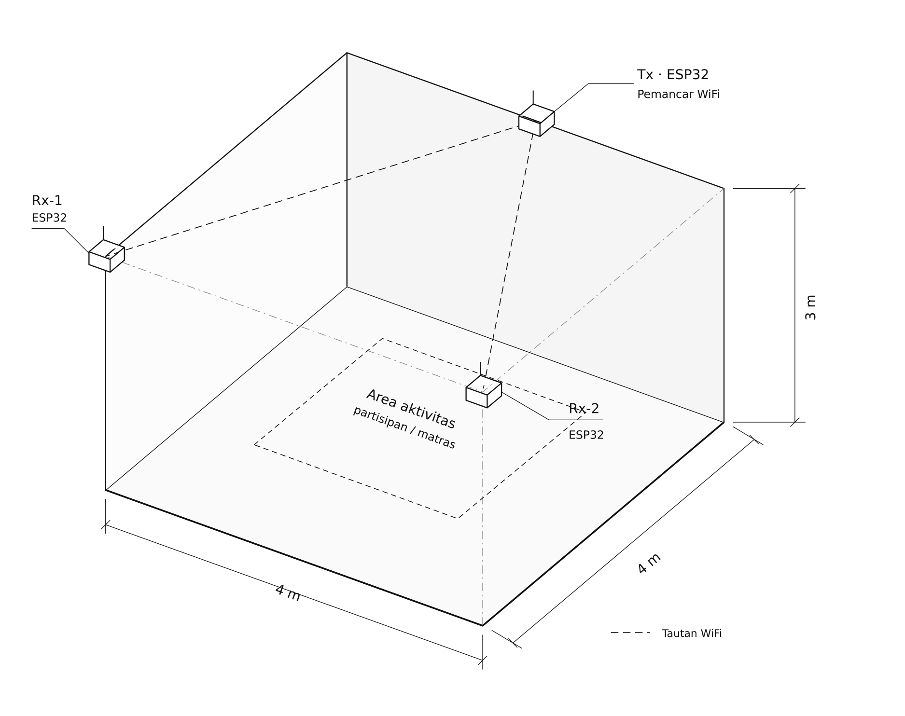
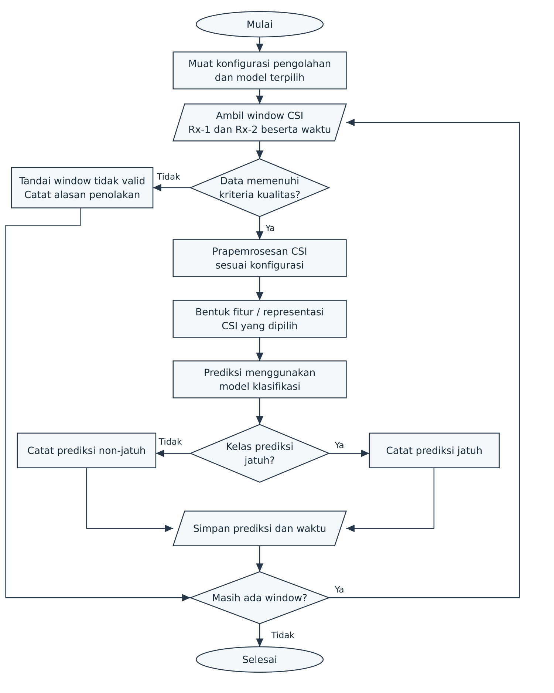

# 3. Metodologi Penelitian

Bab ini menjelaskan metode pengembangan dan pengujian sistem deteksi jatuh berbasis *Channel State Information* (CSI) pada jaringan WiFi. Pembahasan mencakup tipe penelitian, subjek dan objek, lokasi, peralatan, rancangan sistem, pengumpulan data, serta analisis dan evaluasi. Parameter yang dicantumkan menjadi rancangan awal penelitian dan dapat disesuaikan setelah uji pendahuluan tanpa mengubah tujuan utama penelitian.

## 3.1. Tipe Penelitian

Penelitian ini merupakan penelitian implementatif dengan pendekatan pengembangan. Luaran penelitian berupa sistem yang merekam CSI, membentuk representasi perubahan temporal fase relatif dan perubahan amplitudo, serta mengklasifikasikan aktivitas ke dalam kelas jatuh atau non-jatuh. Tahap pengembangan meliputi perancangan perangkat, akuisisi data, prapemrosesan sinyal, pembentukan fitur, pelatihan model, dan evaluasi kinerja.

Pengujian dilakukan melalui peragaan aktivitas di dalam ruangan yang dikendalikan. Data hasil peragaan dianalisis secara kuantitatif untuk mengukur kemampuan sistem dalam mendeteksi jatuh dan menolak aktivitas sehari-hari yang menyerupai jatuh. Model fase relatif dan model amplitudo diuji pada data serta pembagian partisipan yang sama agar hasil keduanya dapat dibandingkan secara langsung.

## 3.2. Subjek dan Objek Penelitian

Subjek penelitian terdiri atas 10 partisipan dewasa sehat berusia 18–35 tahun. Partisipan harus mampu berdiri, berjalan, duduk, dan melakukan simulasi jatuh tanpa alat bantu. Calon partisipan yang memiliki gangguan keseimbangan, cedera otot atau sendi, penyakit jantung, atau kondisi lain yang meningkatkan risiko selama peragaan tidak diikutsertakan. Setiap partisipan menerima penjelasan prosedur, memberikan persetujuan, dan dapat menghentikan keikutsertaan kapan saja.

Objek penelitian adalah perubahan CSI selama aktivitas jatuh dan non-jatuh. Setiap rekaman memuat waktu pengukuran, nomor urut paket, identitas penerima, nilai CSI setiap *subcarrier*, kode anonim partisipan, identitas peragaan, dan label aktivitas. Data identitas pribadi tidak dimasukkan ke berkas pengukuran. Unit masukan model adalah *window* CSI berdurasi 3 detik.

## 3.3. Lokasi Pengambilan Data

Pengambilan data dilakukan di ruang berukuran sekitar 4 m × 4 m × 3 m pada Gedung F Fakultas Ilmu Komputer Universitas Brawijaya. Area peragaan berukuran 2 m × 2 m ditempatkan di bagian tengah ruangan dan dilapisi matras. Posisi perangkat, matras, pintu, serta furnitur dicatat dan dipertahankan selama seluruh sesi utama.

Ruangan digunakan dalam kondisi pintu tertutup dan tanpa orang lain selain partisipan serta dua petugas penelitian. Perangkat WiFi lain yang tidak diperlukan dijauhkan dari area pengujian. Kondisi ruangan, gangguan koneksi, perpindahan furnitur, dan perubahan pemasangan perangkat dicatat dalam log sesi.

## 3.4. Peralatan yang Digunakan

Peralatan penelitian terdiri atas perangkat akuisisi CSI, sensor referensi, perangkat perekaman, dan perlengkapan keselamatan. Konfigurasi menggunakan satu pemancar WiFi dan dua penerima CSI. Rincian peralatan disajikan pada Tabel 3.1.

Tabel 3.1. Peralatan penelitian.

| Kelompok | Komponen | Fungsi dan konfigurasi awal |
| --- | --- | --- |
| Perangkat keras | Satu ESP32 sebagai pemancar WiFi (Tx) | Mengirim paket *ping* UDP pada pita 2,4 GHz dengan laju sasaran 100 paket per detik. |
| Perangkat keras | Dua ESP32 sebagai Rx-1 dan Rx-2 | Merekam CSI dari paket yang diterima pada dua posisi pengamatan. Kedua papan menggunakan tipe dan versi firmware yang sama. |
| Perangkat keras | MR60FDA2 | Memberikan keluaran deteksi pembanding dan membantu pemeriksaan waktu kejadian. Keluarannya disimpan terpisah dari label acuan. |
| Perangkat keras | Komputer | Menyimpan data mentah, menjalankan prapemrosesan, melatih model, dan menghitung hasil evaluasi. |
| Perangkat keras | Catu daya, kabel data, dan dudukan | Menjaga perangkat aktif dan mempertahankan posisi serta orientasi antena. |
| Peralatan pendukung | Matras, meteran, dan penanda lantai | Mengurangi risiko cedera serta memastikan posisi peragaan dan perangkat dapat diulang. |
| Perangkat lunak | ESP-IDF dan firmware akuisisi CSI | Mengatur pengiriman paket, pembacaan CSI, nomor urut paket, identitas perangkat, dan waktu penerimaan. |
| Perangkat lunak | Python | Menjalankan pemeriksaan data, pengolahan sinyal, pembentukan fitur, klasifikasi SVM, dan evaluasi. |

## 3.5. Rancangan Sistem

### 3.5.1. Gambaran Umum Sistem

Pemancar mengirim paket WiFi selama partisipan melakukan aktivitas di area peragaan. Rx-1 dan Rx-2 merekam CSI dari setiap paket yang diterima, lalu mengirimkan hasil akuisisi ke komputer melalui sambungan serial. Komputer menyimpan keluaran setiap penerima dalam berkas terpisah dengan identitas sesi yang sama. MR60FDA2 merekam keluaran deteksi dan waktu kejadian sebagai data pembanding.

Pengembangan model dan penggunaan model dipisahkan. Pada tahap pengembangan, data latih dan validasi digunakan untuk menetapkan prapemrosesan, fitur, serta parameter model. Pada tahap pengujian, konfigurasi tersebut dikunci dan diterapkan pada data uji tanpa penyetelan ulang. Model fase relatif dan model amplitudo mengikuti prosedur yang sama, tetapi menggunakan representasi CSI yang berbeda.

### 3.5.2. Perancangan Perangkat Keras dan Tata Letak

Gambar 3.1 menunjukkan tampilan aksonometrik penempatan perangkat. Pemancar ditempatkan di tengah salah satu sisi ruangan, sedangkan Rx-1 dan Rx-2 ditempatkan pada dua sudut sisi yang berhadapan. Area aktivitas berada di antara pemancar dan kedua penerima agar gerakan tubuh memengaruhi lebih dari satu lintasan pengukuran.

Ketiga ESP32 dipasang pada ketinggian 2,7 m dari lantai dengan antena menghadap ke area aktivitas. Jarak perangkat dari sudut atau titik tengah dinding diukur dan ditandai agar pemasangan dapat diulang. MR60FDA2 dipasang pada salah satu sisi ruangan pada ketinggian 1,5 m dan diarahkan ke pusat matras. Komputer ditempatkan di luar area peragaan.

Jaringan menggunakan WiFi 2,4 GHz, lebar kanal 20 MHz, dan kanal 6. Pemancar mengirim paket dengan laju sasaran 100 paket per detik. Kanal, laju paket, posisi, orientasi, dan catu daya perangkat dipertahankan selama pengambilan data utama. Kinerja penerimaan kedua ESP32 diperiksa sebelum setiap sesi melalui rekaman kondisi kosong selama 30 detik.

### 3.5.3. Perancangan Pengolahan Data CSI

Pengolahan dimulai dengan memeriksa struktur rekaman, nomor urut paket, waktu penerimaan, identitas perangkat, dan kelengkapan nilai CSI. Paket duplikat dibuang. Paket yang hilang dicatat berdasarkan loncatan nomor urut. Rekaman peragaan ditolak apabila lebih dari 10% paket hilang atau terdapat celah tanpa data lebih dari 0,5 detik. Data mentah tidak diubah; hasil pembersihan disimpan sebagai data turunan.

Waktu pengukuran diubah menjadi deret berjarak tetap 0,01 detik melalui interpolasi linear sehingga laju data menjadi 100 sampel per detik. Deret setiap *subcarrier* disaring menggunakan penyaring Butterworth orde empat dengan frekuensi potong 20 Hz. Setelah itu, data dipotong menjadi *window* 3 detik atau 300 sampel dengan pergeseran 0,5 detik. *Window* yang memotong dua aktivitas berbeda tidak digunakan untuk pelatihan.

Representasi utama dibentuk dari fase CSI setiap penerima. Fase dibuka terhadap batas −π dan π, kecenderungan linear antarsubcarrier pada setiap paket dikurangi, lalu perubahan temporal dihitung terhadap sampel sebelumnya. Nilai fase dari Rx-1 dan Rx-2 tidak langsung dikurangkan karena kedua papan memiliki osilator yang berbeda. Fitur kedua penerima dihitung secara terpisah, kemudian digabungkan pada tingkat vektor fitur.

Representasi pembanding dibentuk dari magnitudo CSI. Amplitudo dinormalisasi terhadap median dan rentang antarkuartil pada setiap *subcarrier* menggunakan parameter yang dihitung dari data latih. Perubahan amplitudo dihitung terhadap sampel sebelumnya. Representasi fase dan amplitudo diringkas dengan fitur rata-rata, simpangan baku, *median absolute deviation*, rentang antarkuartil, rentang nilai, energi, dan entropi pada setiap *window*. Seluruh fitur distandardisasi menggunakan rata-rata dan simpangan baku data latih.

### 3.5.4. Perancangan Algoritme Deteksi Jatuh

Algoritme menerima vektor fitur dari satu *window* dan menghasilkan kelas jatuh atau non-jatuh. Pengklasifikasi yang digunakan adalah *support vector machine* dengan kernel *radial basis function* (SVM-RBF). Nilai C dipilih dari 0,1; 1; 10; dan 100, sedangkan nilai gamma dipilih dari 0,01; 0,1; 1; dan opsi *scale*. Kombinasi dengan F1-score validasi tertinggi digunakan pada pengujian.

Proses dimulai dengan memuat konfigurasi prapemrosesan, parameter standardisasi, dan model terlatih. Sistem mengambil *window* berikutnya dari Rx-1 dan Rx-2. Jika kualitas data tidak memenuhi kriteria, *window* ditandai tidak valid dan tidak diberi kelas non-jatuh. *Window* valid menjalani prapemrosesan, pembentukan fitur, standardisasi, dan prediksi SVM.

Prediksi jatuh pada dua *window* berturut-turut digabungkan menjadi satu alarm kejadian. Prediksi berikutnya dalam rentang 5 detik setelah alarm pertama dianggap bagian dari kejadian yang sama. Waktu alarm ditetapkan pada awal *window* pertama yang diprediksi jatuh. Aturan ini diterapkan dengan nilai yang sama pada model fase dan amplitudo.

## 3.6. Teknik Pengumpulan Data

Data dikumpulkan melalui pengukuran CSI dan observasi terstruktur. Setiap partisipan memperagakan empat jenis jatuh, yaitu jatuh ke depan, ke belakang, ke kiri, dan ke kanan. Aktivitas non-jatuh terdiri atas berjalan, duduk, berdiri dari kursi, membungkuk mengambil benda, berjongkok, berbaring secara sengaja, dan duduk cepat. Seluruh aktivitas dipetakan menjadi label biner jatuh atau non-jatuh.

Setiap jenis aktivitas diulang tiga kali oleh setiap partisipan. Dengan 10 partisipan dan 11 jenis aktivitas, jumlah sasaran pengambilan data adalah 330 peragaan, terdiri atas 120 peragaan jatuh dan 210 peragaan non-jatuh. Urutan aktivitas diacak untuk setiap partisipan. Partisipan beristirahat sedikitnya satu menit setelah setiap peragaan jatuh dan dapat meminta waktu istirahat tambahan.

Setiap peragaan direkam selama 10 detik, terdiri atas sekitar 2 detik kondisi awal, pelaksanaan aktivitas, dan sedikitnya 3 detik kondisi akhir. Petugas memberikan aba-aba, menekan penanda kejadian pada program perekam, dan mencatat waktu awal serta akhir aktivitas. Label acuan ditentukan dari aba-aba, penanda kejadian, dan catatan observasi. Keluaran MR60FDA2 disimpan terpisah agar tidak menggantikan label acuan.

Peragaan jatuh dilakukan di atas matras dengan satu petugas berada di sisi partisipan. Partisipan terlebih dahulu menerima contoh gerakan dan melakukan satu latihan. Sesi dihentikan apabila partisipan merasa pusing, nyeri, atau tidak nyaman. Rekaman yang terganggu oleh orang lain, perpindahan perangkat, atau kegagalan akuisisi diulang tanpa menghapus rekaman mentah sebelumnya.

## 3.7. Teknik Analisis Data dan Evaluasi

### 3.7.1. Analisis Deskriptif dan Pembagian Data

Analisis deskriptif merangkum jumlah rekaman, jumlah paket, persentase paket hilang, durasi, jumlah *window* setiap kelas, dan jumlah *window* yang ditolak. Grafik deret waktu fase dan amplitudo digunakan untuk memeriksa kondisi kosong, aktivitas jatuh, serta aktivitas non-jatuh. Ringkasan juga disajikan menurut partisipan, aktivitas, dan penerima.

Pemisahan data dilakukan berdasarkan partisipan agar *window* dari orang yang sama tidak muncul pada lebih dari satu kelompok. Enam partisipan digunakan sebagai data latih, dua sebagai data validasi, dan dua sebagai data uji. Pemilihan partisipan dilakukan secara acak dengan *random seed* 42 dan digunakan tanpa perubahan pada model fase maupun amplitudo. Seluruh *window* yang berasal dari satu peragaan ditempatkan pada kelompok yang sama.

Data latih digunakan untuk menghitung parameter normalisasi dan melatih SVM. Data validasi digunakan untuk memilih C dan gamma serta menetapkan ambang penggabungan alarm. Data uji hanya digunakan setelah seluruh pilihan dikunci. Selain model utama, *majority-class classifier* digunakan sebagai garis dasar untuk memastikan bahwa kinerja model tidak hanya berasal dari ketidakseimbangan kelas.

### 3.7.2. Evaluasi Klasifikasi

Evaluasi pertama dilakukan pada tingkat *window* dengan jatuh sebagai kelas positif. Prediksi dibandingkan dengan label acuan untuk membentuk matriks konfusi pada Tabel 3.2. Hasil dilaporkan bersama jumlah data setiap kelas.

Tabel 3.2. Definisi hasil klasifikasi pada evaluasi per *window*.

| Label acuan | Prediksi jatuh | Prediksi non-jatuh |
| --- | --- | --- |
| Jatuh | *True positive* (TP) | *False negative* (FN) |
| Non-jatuh | *False positive* (FP) | *True negative* (TN) |

Ukuran evaluasi yang dihitung adalah *precision*, *recall*, *specificity*, F1-score, dan *balanced accuracy*:

$$
\mathrm{Precision}=\frac{TP}{TP+FP},\qquad
\mathrm{Recall}=\frac{TP}{TP+FN},
$$

$$
\mathrm{Specificity}=\frac{TN}{TN+FP},\qquad
F_1=\frac{2TP}{2TP+FP+FN},
$$

$$
\mathrm{Balanced\ Accuracy}=\frac{\mathrm{Recall}+\mathrm{Specificity}}{2}.
$$

Evaluasi kedua dilakukan pada tingkat kejadian. Alarm dianggap benar apabila waktunya berada dalam rentang 2 detik sebelum hingga 3 detik setelah interval jatuh pada label acuan. Beberapa alarm dalam rentang satu kejadian dihitung sebagai satu deteksi. Alarm yang tidak berpasangan dengan kejadian jatuh dihitung sebagai *false alarm*. Hasil tingkat kejadian meliputi jumlah jatuh terdeteksi, jumlah jatuh terlewat, jumlah *false alarm*, dan latensi alarm terhadap awal jatuh.

Model fase dan amplitudo dibandingkan berdasarkan hasil pada partisipan uji yang sama. Perbandingan utama menggunakan F1-score, *balanced accuracy*, jumlah jatuh terlewat, dan jumlah *false alarm*. Keluaran MR60FDA2 juga dibandingkan dengan label acuan menggunakan definisi kejadian yang sama, tetapi tidak digunakan untuk melatih model CSI.

### 3.7.3. Analisis Kesalahan Sistem

Setiap *false negative* dan *false positive* ditelusuri ke partisipan, aktivitas, peragaan, penerima, persentase paket hilang, dan posisi waktu dalam rekaman. Analisis dikelompokkan menurut arah jatuh dan jenis aktivitas non-jatuh untuk menemukan pola kegagalan. Aktivitas duduk cepat dan berbaring diperiksa secara khusus karena gerakannya dapat menyerupai transisi jatuh.

Kegagalan akuisisi dilaporkan terpisah dari kesalahan klasifikasi. *Window* yang ditolak tidak dianggap sebagai prediksi non-jatuh, sedangkan kejadian jatuh tanpa data yang memadai dicatat sebagai kegagalan sistem. Kesimpulan penelitian dibatasi pada partisipan dewasa sehat, aktivitas peragaan, konfigurasi perangkat, dan ruangan yang digunakan dalam pengujian.
