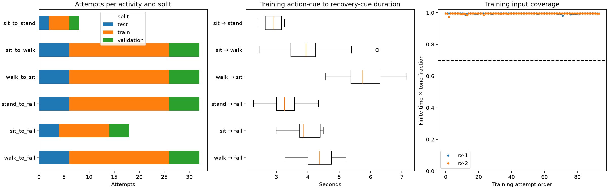
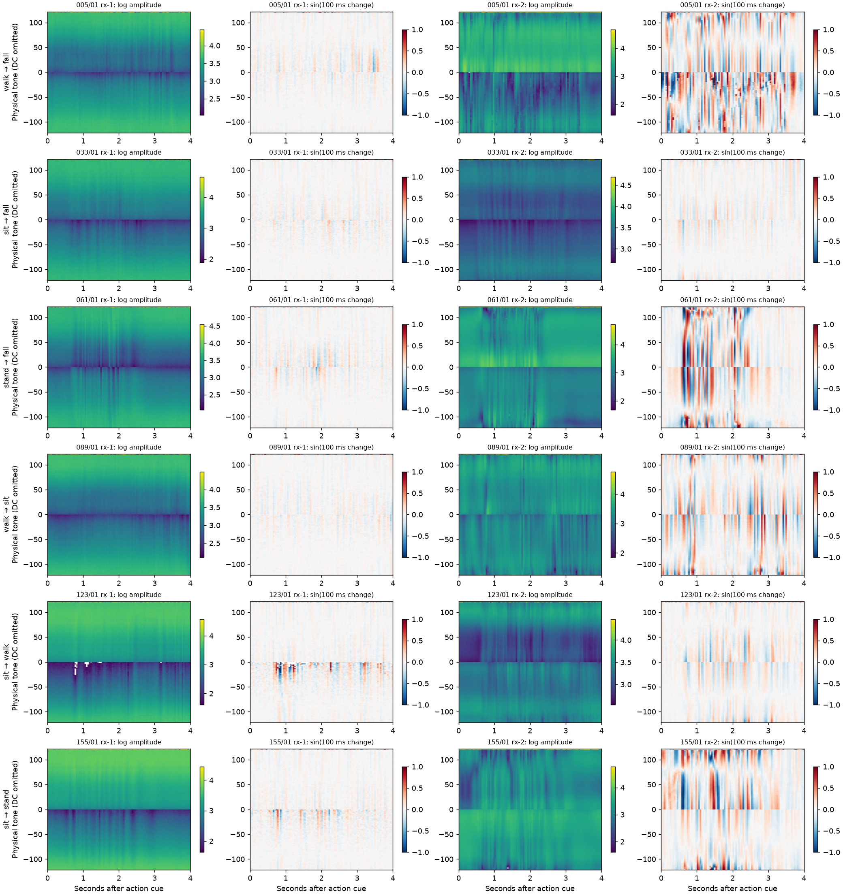
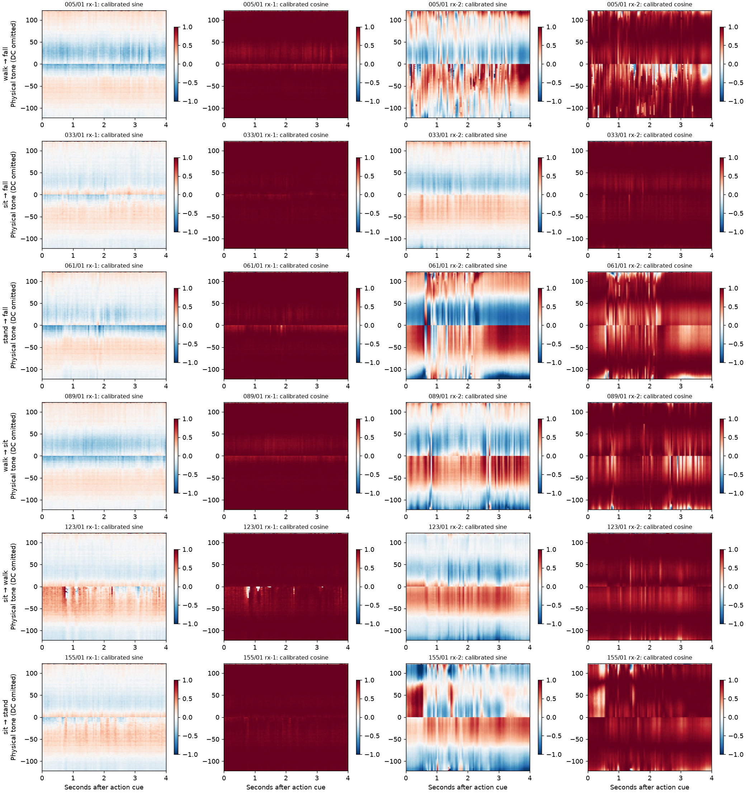
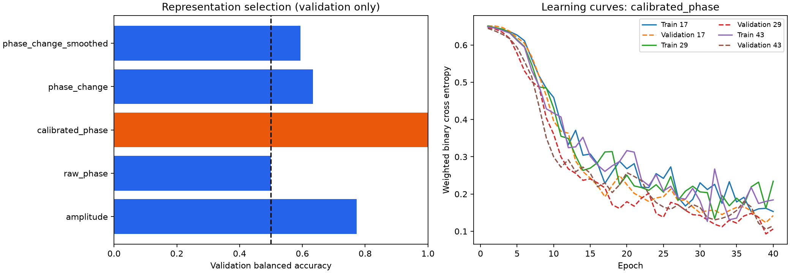
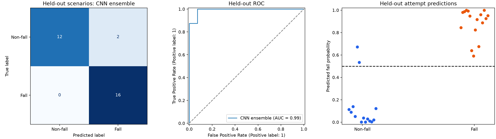

# CSI CNN pilot: executed results

This experiment classifies a fixed, cue-aligned four-second recording as fall or
non-fall. The selected input is **calibrated_phase**. The held-out test set contains
30 attempts in 15 activity/direction scenarios.
The CNN ensemble has balanced accuracy 0.929, fall
recall 1.000, and specificity 0.857.
These are results from one session and participant, not evidence of performance
on new people, rooms, sessions, or continuous streams.

## Data and EDA

Session: `20261026T174653764289Z`. Effective participant:
`akmal`. Accepted and reviewed scope is resolved using
reference-truth labels, then review corrections, then planned labels. Bad or
excluded reviews and non-accepted attempts are excluded. Source-file SHA-256
hashes and dataset hashes are in [manifest.json](manifest.json).

154 attempts remain; 0
additional attempts were excluded by preprocessing quality. Read failures:
0. Counts are train
94, validation 30, test
30. [Inventory](inventory.csv), [quality](quality.csv), and
[split membership](trials.csv) retain the audit trail. Signal examples below use
only training attempts, selected by identity rather than observed disturbance.

## Preprocessing

The pinned canonical HE-LTF decoder filters the transmitter MAC and HE20/MCS0
format, masks amplitudes below 4, and calibrates packet-wise phase slope/offset.
Recorded USB affine clock fits align receivers to the host event timeline;
[quality.csv](quality.csv) records fallback timing and uncertainty when applicable.
The experiment keeps 242 physical tones, removing only DC slots -1, 0, 1.
Receiver streams are aligned by the same cue, retained as separate feature
channels, and combined in the CNN. No receiver is a separate training example.

Each input covers [0, 4) seconds after the action cue, with 100 time bins at
25 Hz. Packets are averaged within each bin per tone. Phase is represented by
sine/cosine components before averaging to avoid a false discontinuity at ±pi.
Phase change is the signed calibrated change over 100 ms, with actual lag at
most 150 ms. Lag endpoints can cross a cue: phase-boundary metadata is not
supplied to the model. Empty bins remain missing; there is no interpolation or
activity-duration-dependent cropping/padding. A short action may include its
recovery, while a long action may be truncated. Actual fall-onset times are
unknown. The 25 Hz binning is a fixed pilot choice, not a validated optimum.

The smoothing ablation averages three adjacent bins (120 ms support), preserving
missing center bins. It uses neighboring samples and the whole input window;
this is offline classification. Training-only channel/tone means and standard
deviations scale all partitions, with a 0.05 standard-deviation floor. Missing
values become zero after scaling, accompanied by explicit finite-value masks.
Both receiver phase-change coverages must reach 70%.
The threshold and all model settings were fixed before test evaluation.

## Split and model

The seeded split assigns entire scenarios within each of the six activity
families to approximately 60/20/20 percent train/validation/test partitions.
Both repetitions, all retakes, all tones, and both receivers stay together.
Membership is frozen before signal-quality exclusions; exclusions do not redraw
it. This is stricter than splitting individual attempts, but every partition
shares the same participant, session, hardware, room, and acquisition protocol.
Activities were collected in blocks, so recording-order drift is a possible
confound. Scenario holdout does not remove that confound.

The CNN has three convolution/ReLU stages (8, 16, 32 channels; strides 2), global
average pooling, dropout 0.25, and one binary output. Learned convolutions receive
the full time-by-tone grid; there is no PCA or tone average before the CNN.
AdamW uses learning rate 0.001 and weight decay
0.01. Training uses class-weighted binary cross entropy,
batches of 16, at most 40 epochs, and
validation-loss early stopping with patience 8. Seeds are
[17, 29, 43]; predictions average the three independently fitted
models. The decision threshold stays at 0.5. No augmentation or architecture
search was performed. Train-only simple logistic and majority baselines provide
reference scores. The quality-only logistic baseline uses missingness summaries
from the four original representations and no signal values.

## Validation selection

Epoch selection minimizes validation loss; representation selection maximizes
ensemble validation balanced accuracy, then ROC AUC, then configured order.
Test predictions are computed only after this selection is saved. The five
candidate scores below are validation results; they do not establish superiority
on an independent session. Code, checkpoint hashes, package versions, and elapsed
training time are in [selection.json](selection.json).

| Input | Validation balanced accuracy | Validation ROC AUC |
| --- | ---: | ---: |
| amplitude | 0.772 | 0.862 |
| raw_phase | 0.500 | 0.446 |
| calibrated_phase | 1.000 | 1.000 |
| phase_change | 0.634 | 0.714 |
| phase_change_smoothed | 0.594 | 0.674 |

## Held-out evaluation

| Model | Accuracy | Balanced accuracy | Fall recall | Specificity | Fall F1 | ROC AUC |
| --- | ---: | ---: | ---: | ---: | ---: | ---: |
| cnn | 0.933 | 0.929 | 1.000 | 0.857 | 0.941 | 0.991 |
| summary_logistic | 0.867 | 0.862 | 0.938 | 0.786 | 0.882 | 0.973 |
| quality_only | 0.633 | 0.647 | 0.438 | 0.857 | 0.560 | 0.844 |
| majority | 0.533 | 0.500 | 1.000 | 0.000 | 0.696 | 0.500 |

The selected CNN identifies 16 falls and misses 0;
it correctly rejects 12 non-falls and flags 2 as
falls. Scenario-cluster bootstrap 95% intervals (2,000 resamples, fixed seed 812)
are [0.786, 1.000]
for balanced accuracy and [1.000,
1.000] for fall recall. These exploratory intervals
condition on this split and do not include participant or selection uncertainty.
If every observed fall is detected, resampling those same successes produces a
degenerate recall interval of [1, 1]. That interval does not establish perfect
population sensitivity or bound the risk of missing a future fall.

| Held-out activity | Attempts | Accuracy at fixed threshold |
| --- | ---: | ---: |
| sit_to_fall | 4 | 1.000 |
| sit_to_stand | 2 | 1.000 |
| sit_to_walk | 6 | 1.000 |
| stand_to_fall | 6 | 1.000 |
| walk_to_fall | 6 | 1.000 |
| walk_to_sit | 6 | 0.667 |

[Per-attempt predictions](test_predictions.csv) retain probabilities for each
seed and the ensemble. [Seed metrics](test_seed_metrics.csv) describe fitting
variability on the same test set; these are not independent test cohorts.

## Interpretation and remaining work

The CNN separates the labels on this within-session holdout, whereas the earlier
descriptive plots did not establish separation. Calibrated phase wins the
validation comparison; its absolute sine/cosine structure may retain static
channel information as well as motion. The 100 ms change inputs have much lower
validation scores in this experiment, so these results do not establish that
short phase-change bursts explain the classification.

The signal-summary logistic baseline reaches balanced accuracy
0.862. The quality-only
baseline reaches balanced accuracy 0.647
and ROC AUC 0.844 without seeing
signal values. Missingness therefore carries label information in this test set,
and acquisition artifacts offer a competing explanation for some predictability.
These comparisons do not isolate how much of the CNN score comes from motion,
static channel structure, recording-order drift, or quality differences.

The present data do not support a session- or participant-independent conclusion.
The four-second window is aligned to an operator cue, not an annotated impact.
Continuous detection, false alarms per hour, onset latency, unseen-activity
performance, and calibration under realistic fall prevalence remain untested.
Collect independent sessions and participants, annotate movement/impact timing,
and evaluate a frozen pipeline on those recordings before making a generalization
claim. Further tuning must use training/validation data; this test partition is
already consumed by the reported evaluation.
