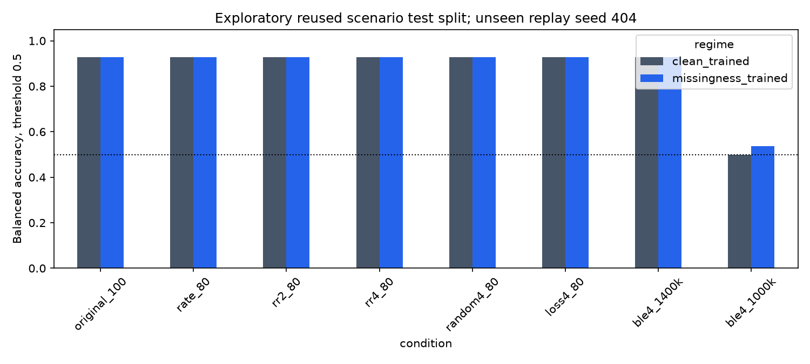
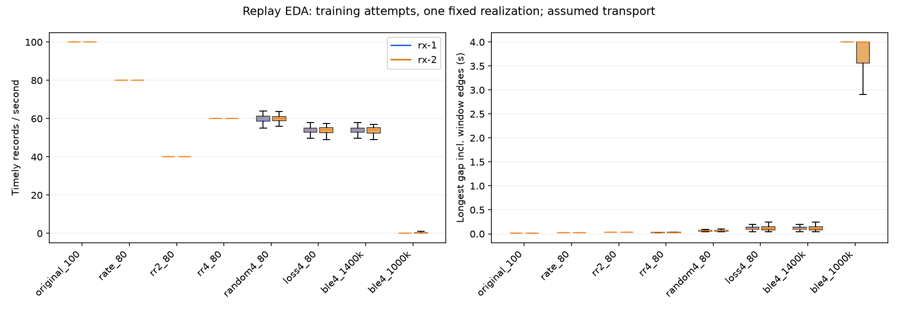
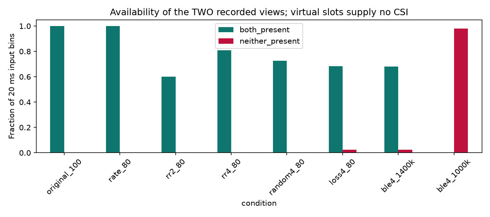
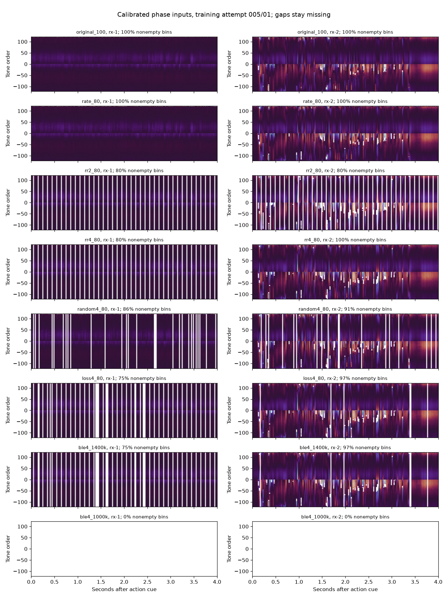
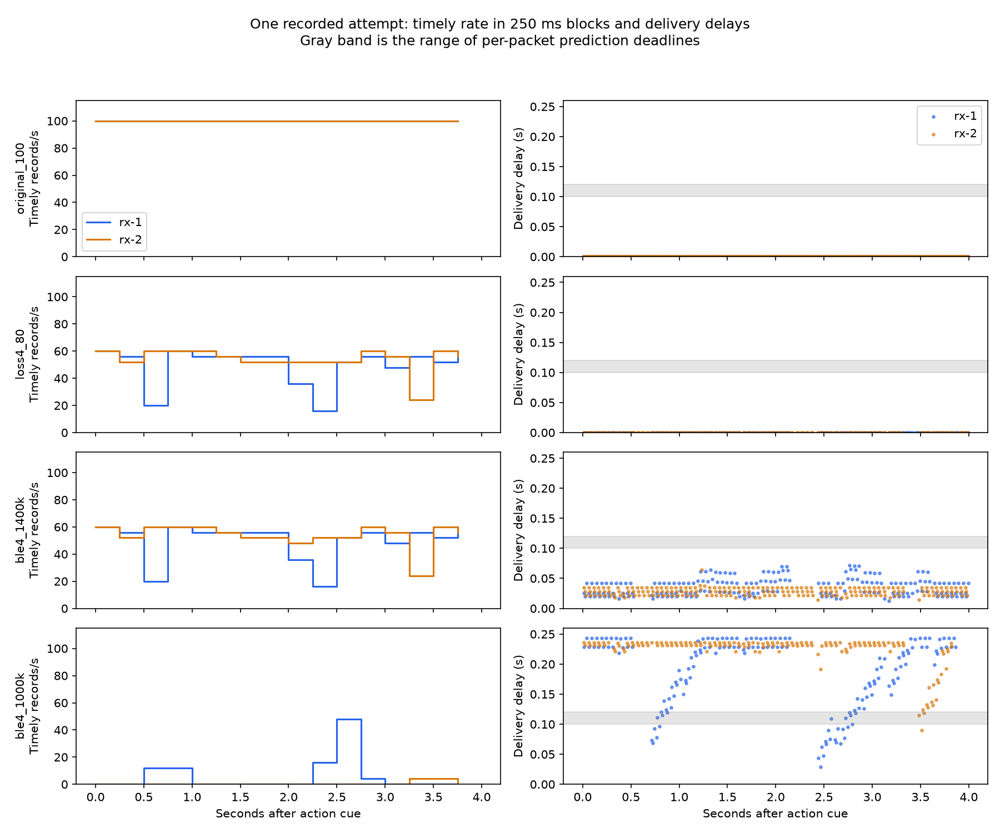
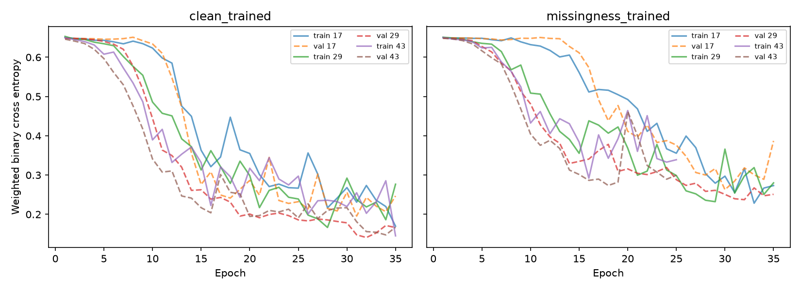

# CSI transport replay pilot

Executed on 154 recorded attempts from session `20261026T174653764289Z`,
using two real receivers and the existing frozen pilot scenario split
({'train': 94, 'test': 30, 'validation': 30}). This is a synthetic transport stress
test and cue-aligned attempt classifier. It does not measure BLE hardware or
establish performance on new sessions, participants, or continuous activity.
The reused test partition was already inspected in the previous pilot; these
scores are exploratory and must not become a new tuning target.

## Measured classifier comparison

Three training seeds form each ensemble. Every row uses the same test attempts
and an unseen replay realization (404). Threshold is
fixed at 0.5. Conditions were prespecified, with no post-loss cohort exclusion.

| regime | condition | balanced_accuracy | fall_recall | specificity | roc_auc | tp | fn | fp | tn |
| --- | --- | --- | --- | --- | --- | --- | --- | --- | --- |
| clean_trained | original_100 | 0.929 | 1.000 | 0.857 | 0.987 | 16 | 0 | 2 | 12 |
| clean_trained | rate_80 | 0.929 | 1.000 | 0.857 | 0.978 | 16 | 0 | 2 | 12 |
| clean_trained | rr2_80 | 0.929 | 1.000 | 0.857 | 0.982 | 16 | 0 | 2 | 12 |
| clean_trained | rr4_80 | 0.929 | 1.000 | 0.857 | 0.982 | 16 | 0 | 2 | 12 |
| clean_trained | random4_80 | 0.929 | 1.000 | 0.857 | 0.982 | 16 | 0 | 2 | 12 |
| clean_trained | loss4_80 | 0.929 | 1.000 | 0.857 | 0.987 | 16 | 0 | 2 | 12 |
| clean_trained | ble4_1400k | 0.929 | 1.000 | 0.857 | 0.987 | 16 | 0 | 2 | 12 |
| clean_trained | ble4_1000k | 0.500 | 1.000 | 0.000 | 0.656 | 16 | 0 | 14 | 0 |
| missingness_trained | original_100 | 0.929 | 1.000 | 0.857 | 0.973 | 16 | 0 | 2 | 12 |
| missingness_trained | rate_80 | 0.929 | 1.000 | 0.857 | 0.969 | 16 | 0 | 2 | 12 |
| missingness_trained | rr2_80 | 0.929 | 1.000 | 0.857 | 0.973 | 16 | 0 | 2 | 12 |
| missingness_trained | rr4_80 | 0.929 | 1.000 | 0.857 | 0.973 | 16 | 0 | 2 | 12 |
| missingness_trained | random4_80 | 0.929 | 1.000 | 0.857 | 0.973 | 16 | 0 | 2 | 12 |
| missingness_trained | loss4_80 | 0.929 | 1.000 | 0.857 | 0.978 | 16 | 0 | 2 | 12 |
| missingness_trained | ble4_1400k | 0.929 | 1.000 | 0.857 | 0.978 | 16 | 0 | 2 | 12 |
| missingness_trained | ble4_1000k | 0.536 | 1.000 | 0.071 | 0.826 | 16 | 0 | 13 | 1 |

Scenario-cluster bootstrap intervals are in `test_intervals.json`; they condition
on this one reused split/session. Seed results and attempt-level probabilities
are included. They do not represent uncertainty across people or hardware.

## Interpretation of the executed run

Both ensembles classify 28/30 attempts correctly in seven conditions, including
scheduled gaps, random grants, extra burst losses and the 1.4 Mbit/s replay.
Both detect 16/16 falls with 2/14 false-positive non-falls. The clean-trained
model already tolerates these patterns; this run demonstrates no additional
threshold-score benefit from missingness training. Probabilities and ROC AUC
still change, so identical decisions do not establish policy equivalence.

Replay includes countdown before the action window, so queues are warmed up
rather than artificially reset at the cue. The assumed 1.0 Mbit/s case produces
sustained queueing under the configured
fragment cost, grant guard and buffer policy. Many records miss their 100 ms
prediction grace even though they eventually arrive before queue expiry.
Balanced accuracy is 0.500/0.536 for clean/missingness training, with 14/14 and
13/14 false-positive non-falls. This is not evidence that augmentation solves
delivery starvation. It motivates evaluating fresher-first/shorter-expiry
policies and lower offered load in a new, prespecified experiment.

The 0.647 original-condition missingness-only balanced accuracy keeps acquisition
confounding unresolved. All conclusions remain limited to the stated replay
assumptions, two measured views, and the reused within-session scenario split.
No minimum physical adapter throughput or four-view performance was measured.

## Training-cohort packet EDA

The following measurements use training attempts and realization 101 only.
Timely means delivered by the capture bin's end plus the fixed 100 ms grace.
Longest gaps include unsupported intervals at the edges of the four-second window.

| condition | receiver | attempts | median_timely_hz | p10_timely_hz | p90_longest_gap_s | median_p95_delay_s | median_peak_queue |
| --- | --- | --- | --- | --- | --- | --- | --- |
| ble4_1000k | rx-1 | 94 | 0.000 | 0.000 | 4.000 | 0.239 | 16.000 |
| ble4_1000k | rx-2 | 94 | 0.000 | 0.000 | 4.000 | 0.241 | 16.000 |
| ble4_1400k | rx-1 | 94 | 54.000 | 51.250 | 0.190 | 0.064 | 5.000 |
| ble4_1400k | rx-2 | 94 | 54.000 | 51.500 | 0.180 | 0.062 | 5.000 |
| loss4_80 | rx-1 | 94 | 54.000 | 51.250 | 0.190 | 0.000 | 0.000 |
| loss4_80 | rx-2 | 94 | 54.000 | 51.500 | 0.180 | 0.000 | 0.000 |
| original_100 | rx-1 | 94 | 100.000 | 100.000 | 0.010 | 0.000 | 0.000 |
| original_100 | rx-2 | 94 | 100.000 | 100.000 | 0.010 | 0.000 | 0.000 |
| random4_80 | rx-1 | 94 | 60.250 | 57.750 | 0.077 | 0.000 | 0.000 |
| random4_80 | rx-2 | 94 | 60.000 | 57.750 | 0.080 | 0.000 | 0.000 |
| rate_80 | rx-1 | 94 | 80.000 | 80.000 | 0.020 | 0.000 | 0.000 |
| rate_80 | rx-2 | 94 | 80.000 | 80.000 | 0.020 | 0.000 | 0.000 |
| rr2_80 | rx-1 | 94 | 40.000 | 40.000 | 0.030 | 0.000 | 0.000 |
| rr2_80 | rx-2 | 94 | 40.000 | 40.000 | 0.030 | 0.000 | 0.000 |
| rr4_80 | rx-1 | 94 | 60.000 | 60.000 | 0.030 | 0.000 | 0.000 |
| rr4_80 | rx-2 | 94 | 60.000 | 60.000 | 0.030 | 0.000 | 0.000 |

The next figure uses the first cohort attempt and test replay seed, after model
freezing, to illustrate time-varying availability and queue delay. It is an
example rather than an aggregate result. Deadline bands vary with each
packet's position inside its 20 ms capture bin.

## Replay assumptions

- `original_100` preserves original packet values, timing and natural losses,
  with ideal replacement transport. `rate_80` retains four of every five source
  rounds, preserving 10/20 ms spacing; it is not a uniform 12.5 ms hardware trace.
- `rr2_80` makes one of the two actual views blind per retained round. Four-slot
  cases make each actual view blind on its assigned turns and add two virtual
  traffic sources. Virtual sources contain byte workloads only, never CSI.
- A grant owner is unavailable for its retained round. A separate uniform
  target-rate clock supplies equal-length grants after a 1 ms sensing guard;
  grants are assumed announced ahead of time. Source capture times retain
  their original thinning jitter. This avoids assigning the repeated 20 ms
  thinning gap to the same receiver on every round-robin cycle.
  Schedule phases/seeds are label-independent. Actual BLE controller events,
  maintenance traffic, ACK latency, RF interference, and stack behavior are
  not reproduced. On-time transfer completion is the application receipt proxy.
- Additional losses: 5% independent loss, a per-round burst-entry probability
  0.015, and burst-exit probability 0.25. These are assumed stresses, not
  estimated ESP32 loss rates. Separate RNG streams keep capture losses paired
  when changing only the transport capacity.
- Constrained cases assume 1.4 or 1.0 Mbit/s shared application service, 32-record
  queues, 250 ms age expiry, oldest-record overflow eviction, 3% whole-transfer
  failure and one retry. A record costs CSI bytes + 119 metadata bytes, plus
  12 assumed header bytes per 232-byte fragment. Partial service carries into
  that receiver's later grants. Unused capacity never accumulates or spills
  into another receiver's grant. Virtual traffic is idealized before injected
  losses; it does not duplicate the original real receivers' natural loss.
- Source losses stay missing. The source sequence grid and USB affine clock
  mapping are reconstructed retrospectively. The replay cannot recover missing
  source observations or emulate changed AGC/phase behavior under real BLE.

## Preprocessing and training

The unchanged pinned HE-LTF decoder performs packet-local phase masking and
weighted linear phase calibration. All 242 usable physical tones remain.
There is no temporal denoising or interpolation. Four-second action-cue windows
use 50 bins/s; circular phases are averaged through sine/cosine only after
simulated capture loss and per-bin delivery deadlines are applied.

The CNN receives four phase channels, four finite-value masks, two packet-count
channels (scaled by two source packets/bin), and two bounded age channels.
Age uses only packets captured before that bin ends and received before its
deadline. A placeholder is zero only after train-only normalization. Those
additional channels expose losses even when a bin still contains one sample.
The prediction uses the complete four-second window plus delivery grace;
this is not a measured fall-alarm latency or streaming detector.

Both regimes use the same original attempts and maximum optimizer steps.
Clean training sees the original condition; missingness training draws one
condition/realization per attempt per epoch. Training replay seeds are 101/202,
validation uses 303, and test uses 404. All variants of a source attempt remain
in its frozen scenario partition. Both regimes share a normalizer fitted only
to original training attempts. Architecture is the pilot's small three-layer
CNN, AdamW, class-weighted BCE and validation early stopping. Clean checkpoints
minimize original-condition validation BCE; augmented checkpoints minimize
equal-condition validation BCE. Both regimes are reported without test-based
selection. Training took 221.6 seconds.

## Missingness-only diagnostic

This baseline sees availability, packet-count and age summaries, without signal
values. Nonchance performance can reflect acquisition/cohort confounding and
must be considered when interpreting CNN results. Signal-summary logistic and
majority comparisons are also in `test_metrics.csv`.

| regime | condition | balanced_accuracy | roc_auc |
| --- | --- | --- | --- |
| clean_trained | original_100 | 0.647 | 0.799 |
| clean_trained | rate_80 | 0.500 | 0.500 |
| clean_trained | rr2_80 | 0.500 | 0.500 |
| clean_trained | rr4_80 | 0.500 | 0.500 |
| clean_trained | random4_80 | 0.500 | 0.500 |
| clean_trained | loss4_80 | 0.500 | 0.500 |
| clean_trained | ble4_1400k | 0.500 | 0.500 |
| clean_trained | ble4_1000k | 0.500 | 0.500 |
| missingness_trained | original_100 | 0.500 | 0.496 |
| missingness_trained | rate_80 | 0.500 | 0.491 |
| missingness_trained | rr2_80 | 0.500 | 0.464 |
| missingness_trained | rr4_80 | 0.424 | 0.594 |
| missingness_trained | random4_80 | 0.500 | 0.509 |
| missingness_trained | loss4_80 | 0.500 | 0.607 |
| missingness_trained | ble4_1400k | 0.500 | 0.607 |
| missingness_trained | ble4_1000k | 0.438 | 0.371 |

## Reproducibility and limits

`manifest.json` pins 1082 source hashes, all prepared
array hashes, reused decoder/model code, config and split. `selection.json`
pins checkpoints and package versions. Raw data is read-only. Large arrays
and checkpoints stay in ignored `artifacts/`; this folder contains small
reports, plots, diagnostics and predictions. Rerun commands are in the README.

This pilot can assess robustness to the stated missingness/service model for
two measured CSI views. Four-receiver model performance, actual BLE feasibility,
true uniform 80 Hz sampling, independent-session generalization and alarm
latency require new measurements. No simulated throughput is a hardware result.
