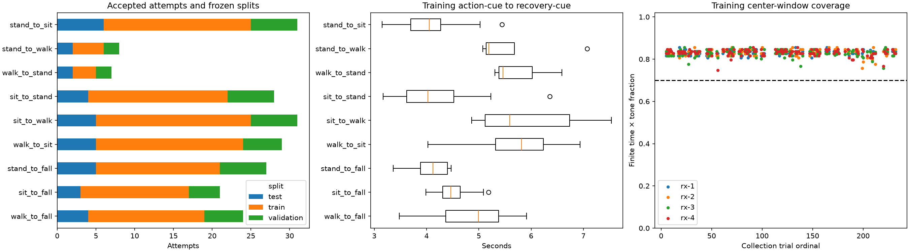
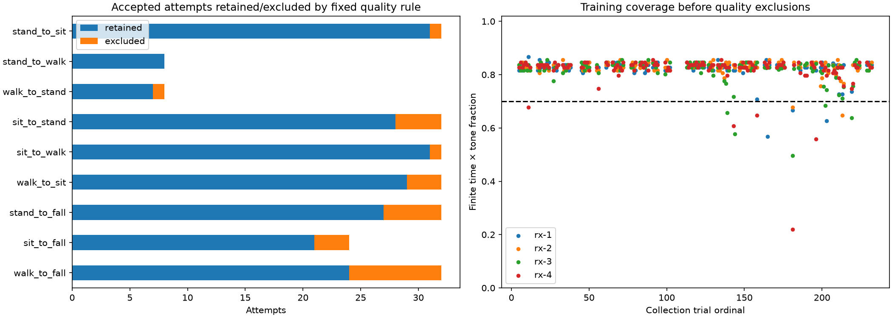
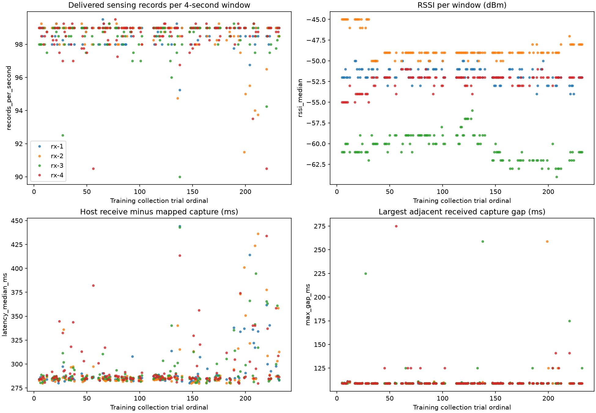
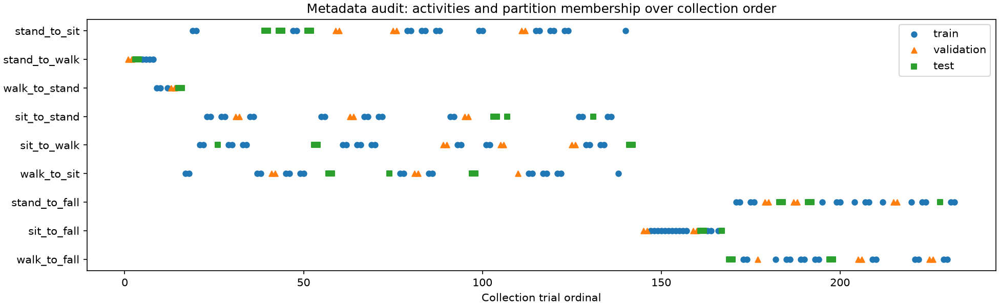
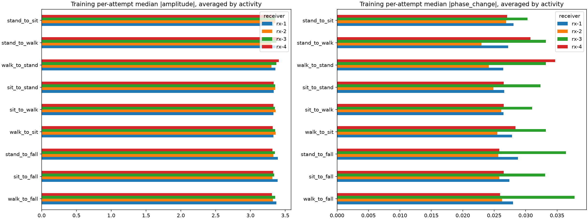
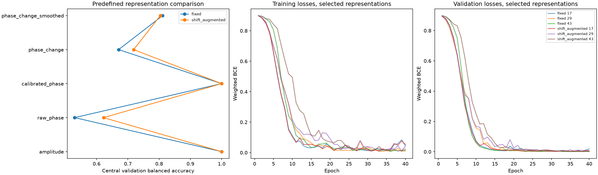
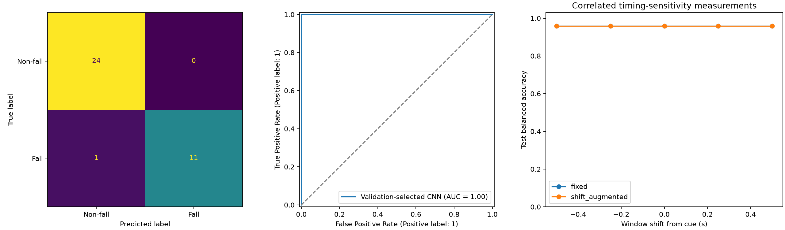

# Four-receiver CSI EDA and CNN experiment

The completed session `20261104T081805521126Z` contains 255 attempts: {'accepted': 232, 'invalid': 22, 'rejected': 1}. The experiment retains 206 accepted attempts across 112 activity/direction scenarios and nine activity families, with 26 additional signal-quality exclusions. One ESP32-C5 transmitter supplies four real receiver views. All recordings belong to participant `khaelano` in one session; this is exploratory binary attempt classification.

## Inventory and EDA

Whole scenarios, including every repetition, retake and receiver, stay within one seeded partition. Membership was frozen before signal-quality reads: {'test': 36, 'train': 128, 'validation': 42}. CSI values in the EDA come exclusively from training attempts. Inventory and split metadata describe all partitions.

| label | test | train | validation |
| --- | --- | --- | --- |
| walk_to_fall | 4 | 15 | 5 |
| sit_to_fall | 3 | 14 | 4 |
| stand_to_fall | 5 | 16 | 6 |
| walk_to_sit | 5 | 19 | 5 |
| sit_to_walk | 5 | 20 | 6 |
| sit_to_stand | 4 | 18 | 6 |
| walk_to_stand | 2 | 3 | 2 |
| stand_to_walk | 2 | 4 | 2 |
| stand_to_sit | 6 | 19 | 6 |

Quality filtering uses no labels, but its observed exclusions can still differ by class. The class totals below describe attrition before any model fitting. Scores apply to the retained subset and do not measure performance on excluded low-coverage attempts.

| target | eligible | retained | excluded |
| --- | --- | --- | --- |
| 0 | 144 | 134 | 10 |
| 1 | 88 | 72 | 16 |

The following training center-window summaries count delivered sensing records per four-second window. A received timestamp gap includes scheduling and delivery effects; it is not a direct RF-loss probability. Latency is host receipt minus mapped transmitter enqueue time, rather than a measurement of ADC acquisition time.

| receiver | median_records_s | minimum_coverage | median_latency_ms |
| --- | --- | --- | --- |
| rx-1 | 99.000 | 0.806 | 285.099 |
| rx-2 | 99.000 | 0.757 | 284.587 |
| rx-3 | 98.875 | 0.757 | 285.724 |
| rx-4 | 99.000 | 0.747 | 286.292 |

Activity labels are blocked in collection order. Scenario separation prevents repeated-window leakage, but does not remove shared participant, room, time, equipment or recording-condition effects. The collection-order and quality-only controls below help expose these associations; they do not establish the causal signal used by a CNN.

Full receiver-by-activity galleries show [log amplitude](figures/eda_amplitude_examples.png), [raw phase](figures/eda_raw_phase_examples.png), [calibrated phase](figures/eda_calibrated_phase_examples.png), and [100 ms phase change](figures/eda_phase_change_examples.png). Each uses the first training attempt per activity, selected without ranking its signal. Phase heatmaps use ±π radians. Summary phase values are reconstructed with atan2 from binned sine/cosine components; they are descriptive, not original unbinned phase statistics.

`eda_training_receiver_correlations.csv` gives Spearman correlations between receivers' per-attempt median absolute values, separately for each representation. These aggregate associations are not waveform synchronization measures. `eda_training_window_support.csv` reports how often the recovery cue falls after each four-second training window. A cue window ending before recovery does not establish whether impact is present or absent; verified impact annotations are unavailable.

## Preprocessing and window schema

The canonical repository loader verifies CSI/timing sequence and receiver-timestamp alignment, validates the gateway capture sidecar and its epoch identities, filters the recorded transmitter's HE20 MCS0/20 MHz sensing link, and sorts only derived views by mapped transmitter enqueue time. Missing gateway alignment is an error; host arrival time is never substituted. The inherited loader calls this time source BLE in its string, but these inputs use the actual `gateway_timing.jsonl` sidecar. The experiment records an explicit gateway label.

Driver `rx_state != 0` packets are masked. Canonical physical-slot, weak-amplitude and finite-value masks remain in force. All 242 valid physical HE20 tones are retained; only the three structural DC tones −1, 0, +1 are removed. There is no frequency reduction, gap interpolation or synthetic receiver data.

Every attempt has five four-second windows: `[cue + δ, cue + δ + 4)`, where δ is −0.50, −0.25, 0, +0.25 or +0.50 seconds. Signals are averaged inside 25 Hz bins (100 time bins); sine/cosine components preserve circular phase during averaging. Windows can include countdown/recovery or omit part of a longer action. The operator action cue is not a verified fall-impact timestamp.

Representations are log1p amplitude, raw-phase sine/cosine, calibrated-phase sine/cosine, 100 ms calibrated circular-change sine/cosine, and a three-bin smoothing ablation of that change. The 100 ms lag rejects support beyond 150 ms. It may use pre-window packets, including across operator phase cues; it is a fixed-lag signal feature, not a phase-segment duration measure. Smoothing is centered/offline, does not fill missing center bins, and does not establish causal live performance. Each receiver in each offset must meet the predefined 70% phase-change coverage threshold. An attempt failing any offset is removed from every scheme without redrawing the split.

Per-channel/tone means and scales use training inputs only (scale floor 0.05). The fixed scheme fits its zero-offset training windows; augmentation fits all configured training offsets. Missing normalized values become zero and each channel gets an explicit finite-value mask. Thus amplitude has eight model channels and phase representations have sixteen, combining all four receiver views.

## CNN training and validation

The reused small CNN has three convolution layers (8, 16 and 32 outputs), ReLU, global average pooling, dropout 0.25 and one fall logit. Class-weighted BCE and AdamW use learning rate 0.001, weight decay 0.01, batch size 16, at most 40 epochs and patience 8. Seeds [17, 29, 43] produce a three-model probability ensemble. CPU deterministic algorithms are enabled.

The fixed scheme sees offset zero. The augmented scheme chooses one seeded uniform offset per training attempt each epoch. Both have the same attempts and maximum optimizer-update budget; augmentation does not multiply training examples or update counts. Early stopping can yield different actual epoch counts. Validation always uses one central window per attempt. Normalization differs consistently with each scheme's training distribution.

The selection rule is highest central validation ensemble balanced accuracy, then ROC AUC, then predefined configuration order, with a fixed 0.5 decision threshold. The selected representations are `{'fixed': 'amplitude', 'shift_augmented': 'amplitude'}`. The overall frozen winner is `{'scheme': 'fixed', 'representation': 'amplitude'}`. All selections were saved before test scoring. Comparing separately selected representations is a pipeline comparison, not an isolated causal estimate of shift augmentation.

| scheme | representation | balanced_accuracy | roc_auc | fall_recall | specificity |
| --- | --- | --- | --- | --- | --- |
| fixed | amplitude | 1.000 | 1.000 | 1.000 | 1.000 |
| fixed | raw_phase | 0.530 | 0.565 | 0.800 | 0.259 |
| fixed | calibrated_phase | 1.000 | 1.000 | 1.000 | 1.000 |
| fixed | phase_change | 0.670 | 0.743 | 0.600 | 0.741 |
| fixed | phase_change_smoothed | 0.811 | 0.874 | 0.733 | 0.889 |
| shift_augmented | amplitude | 1.000 | 1.000 | 1.000 | 1.000 |
| shift_augmented | raw_phase | 0.622 | 0.669 | 0.467 | 0.778 |
| shift_augmented | calibrated_phase | 1.000 | 1.000 | 1.000 | 1.000 |
| shift_augmented | phase_change | 0.719 | 0.817 | 0.733 | 0.704 |
| shift_augmented | phase_change_smoothed | 0.804 | 0.874 | 0.867 | 0.741 |

Training took 8.30 minutes. Each epoch has 8 optimizer updates. Dependency versions: `{'numpy': '2.5.4', 'pandas': '2.3.3', 'torch': '2.14.1+cpu', 'scikit-learn': '1.9.1', 'matplotlib': '3.11.2'}`. The CPU environment/lock are reused from `../03_cnn_baseline`; local code is imported explicitly rather than copied.

## Held-out attempt evaluation

There are 36 test attempts across 21 scenarios. Each row below uses one center window per attempt. Fall is the positive class. Summary logistic uses standardized global channel means/standard deviations of the selected input and masks. Quality-only logistic sees coverage of each representation, packet counts, maximum capture gaps and driver-error counts per receiver. Collection-order logistic sees only trial ordinal. Baseline transforms and classifiers fit central training attempts only, with no test fitting.

| scheme | model | n | balanced_accuracy | fall_recall | specificity | roc_auc | tp | fn | fp | tn |
| --- | --- | --- | --- | --- | --- | --- | --- | --- | --- | --- |
| fixed | cnn | 36 | 0.958 | 0.917 | 1.000 | 1.000 | 11 | 1 | 0 | 24 |
| fixed | summary_logistic | 36 | 0.917 | 0.833 | 1.000 | 0.990 | 10 | 2 | 0 | 24 |
| fixed | quality_only | 36 | 0.521 | 0.500 | 0.542 | 0.479 | 6 | 6 | 11 | 13 |
| fixed | collection_order | 36 | 0.958 | 1.000 | 0.917 | 1.000 | 12 | 0 | 2 | 22 |
| fixed | majority | 36 | 0.500 | 0.000 | 1.000 | 0.500 | 0 | 12 | 0 | 24 |
| shift_augmented | cnn | 36 | 0.958 | 0.917 | 1.000 | 1.000 | 11 | 1 | 0 | 24 |
| shift_augmented | summary_logistic | 36 | 0.917 | 0.833 | 1.000 | 0.990 | 10 | 2 | 0 | 24 |
| shift_augmented | quality_only | 36 | 0.521 | 0.500 | 0.542 | 0.479 | 6 | 6 | 11 | 13 |
| shift_augmented | collection_order | 36 | 0.958 | 1.000 | 0.917 | 1.000 | 12 | 0 | 2 | 22 |
| shift_augmented | majority | 36 | 0.500 | 0.000 | 1.000 | 0.500 | 0 | 12 | 0 | 24 |

The validation-selected CNN obtains center-window balanced accuracy 0.958 on 36 attempts (11 detected falls, 1 missed falls, 0 false-positive non-falls). Collection order alone obtains 0.958, and the quality-only control obtains 0.521. These controls quantify associations in this recording; the CNN score does not isolate a motion-specific fall signal.

Scenario-cluster 95% bootstrap intervals (2,000 draws, seed 812), conditional on this split and session:

- fixed: {'balanced_accuracy': [0.8636363636363636, 1.0], 'fall_recall': [0.7272727272727273, 1.0], 'specificity': [1.0, 1.0], 'roc_auc': [0.9999999999999999, 1.0]}
- shift_augmented: {'balanced_accuracy': [0.8636363636363636, 1.0], 'fall_recall': [0.7272727272727273, 1.0], 'specificity': [1.0, 1.0], 'roc_auc': [0.9999999999999999, 1.0]}

## Backward/forward timing sensitivity

All offsets use the already frozen per-scheme representation, scaler, checkpoints and threshold. The same held-out attempts appear at every offset; these are correlated robustness measurements, not independent samples or a larger test cohort. No offset or model was selected using these test scores.

| scheme | offset_seconds | balanced_accuracy | fall_recall | specificity | tp | fn | fp | tn |
| --- | --- | --- | --- | --- | --- | --- | --- | --- |
| fixed | -0.500 | 0.958 | 0.917 | 1.000 | 11 | 1 | 0 | 24 |
| fixed | -0.250 | 0.958 | 0.917 | 1.000 | 11 | 1 | 0 | 24 |
| fixed | 0.000 | 0.958 | 0.917 | 1.000 | 11 | 1 | 0 | 24 |
| fixed | 0.250 | 0.958 | 0.917 | 1.000 | 11 | 1 | 0 | 24 |
| fixed | 0.500 | 0.958 | 0.917 | 1.000 | 11 | 1 | 0 | 24 |
| shift_augmented | -0.500 | 0.958 | 0.917 | 1.000 | 11 | 1 | 0 | 24 |
| shift_augmented | -0.250 | 0.958 | 0.917 | 1.000 | 11 | 1 | 0 | 24 |
| shift_augmented | 0.000 | 0.958 | 0.917 | 1.000 | 11 | 1 | 0 | 24 |
| shift_augmented | 0.250 | 0.958 | 0.917 | 1.000 | 11 | 1 | 0 | 24 |
| shift_augmented | 0.500 | 0.958 | 0.917 | 1.000 | 11 | 1 | 0 | 24 |

Predictions change across offsets for {'fixed': 0, 'shift_augmented': 0} test attempts. These counts measure timing sensitivity on this cohort; they are not continuous detector false-alarm rates. Per-attempt/seed probabilities, activity errors and stability ranges are saved in the accompanying CSVs.

## Limits and reproducibility

One participant and one session cannot establish generalization to new people, sessions, rooms, device positions, natural falls or continuous daily activity. The action cue is operator generated, video exposure/pipeline delay is unknown, and this experiment does not infer impact timing from video. Collection order and receiver-quality associations can inflate within-session discrimination. A high CSI score therefore requires interpretation alongside the controls rather than attribution to a fall mechanism. The test set has now been inspected and must not be reused as an untouched selection set in later tuning.

Raw recordings were read without modification. `manifest.json` records raw-input SHA-256 hashes, code, configuration, derived arrays and frozen splits; `selection.json` hashes checkpoints and records model selection. Large arrays and CPU checkpoints remain ignored in `artifacts/four_rx_v1/`; small tables, plots and this report are copied to `results/four_rx_v1/`. The executed notebook reads these results by default. Reruns should use a fresh output directory.
