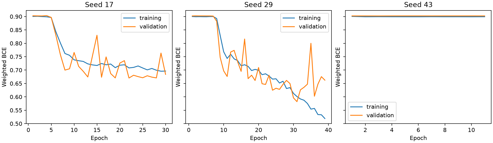
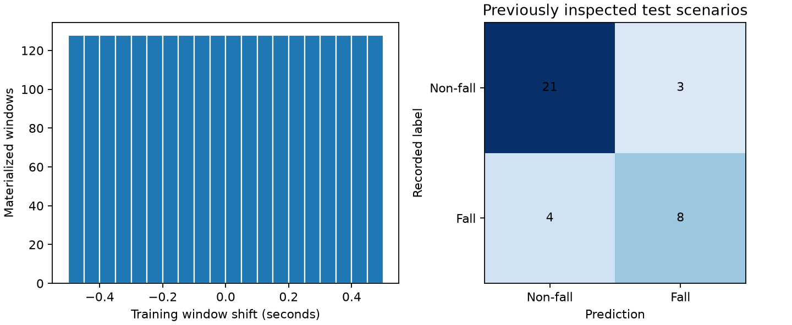
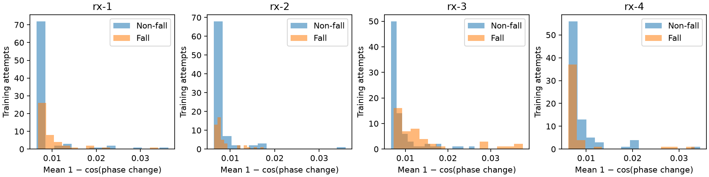

# Phase-change CNN with 20 explicit random shifts

This run uses calibrated phase change only, with no fitted normalization and
no amplitude features. Each of 128 training attempts contributes
20 reproducibly random shifts in [−0.5, +0.5] seconds and its central window:
2688 materialized training examples, all visited on every epoch.
Every training scenario contributes at least 20 shifted
examples. All repetitions, receiver views and shifts stay in their original
scenario split. Validation has 42 central windows; the
previously inspected test split has 36 central windows.

The raw session is `20261104T081805521126Z`. This run preserves the parent
206-attempt cohort and its 26 quality exclusions. Augmentation supplies timing
variation; overlapping windows do not create independent recordings.
All random candidates passed the 70% per-receiver coverage requirement; no replacements were needed.

Four-second windows use 25 Hz bins and 242 physical tones for each of four
receivers. Signed calibrated phase differences use the packet at or before
100 ms earlier, with an inclusive maximum lag of 150 ms. Sine and cosine are
averaged in each bin, retaining eight feature planes and eight masks. Values
remain in [−1, 1]; only missing values become zero. There is no smoothing,
standardization, batch normalization or per-window recentering.

Timing comparisons use integer nanoseconds in both offline and live Rust
preprocessing. The older Python analysis can reject an exact 150 ms lag after
floating-point subtraction (observed in `007/01`). This run uses the exact
inclusive cutoff and leaves the old experiment unchanged. Independent NumPy
window calculations checked 2766 candidate
windows: maximum feature error 1.16e-10,
with identical finite masks. The comparison reuses decoded packet phases and
independently calculates wrapped differences, lag admission and bin means.

Three fresh SmallCNN fits (seeds 17, 29, 43) retain the previous architecture,
with 16 input channels. Training uses class-weighted BCE and AdamW, up to 40
epochs with patience 8. Each seed's checkpoint minimizes central validation
BCE. The ensemble averages three sigmoid probabilities at fixed threshold 0.5;
neither architecture nor threshold was selected using test scores. Training
took 12.14 minutes on this machine.

| Partition | Attempts | Balanced accuracy | Fall recall | Specificity | ROC AUC |
| --- | ---: | ---: | ---: | ---: | ---: |
| Validation | 42 | 0.807 | 0.800 | 0.815 | 0.877 |
| Test (reused) | 36 | 0.771 | 0.667 | 0.875 | 0.854 |

Test decisions: TP 8, FN 4, FP 3, TN 21.
The fully valid synthetic zero-phase-change input scores 0.263251;
this diagnostic is not measured standing accuracy.

Seed diagnostics:

- Seed 17: best epoch 22, validation balanced accuracy 0.704, probability range 0.2001–0.9871.
- Seed 29: best epoch 31, validation balanced accuracy 0.789, probability range 0.1103–0.9948.
- Seed 43: best epoch 3, validation balanced accuracy 0.500, probability range 0.5017–0.5020.

The near-constant seed did not learn useful separation. All three predeclared
seeds remain in the equal-weight ensemble; no test-based pruning or retraining
was performed.

Read-only raw replay verified 23 real windows, including all 20 random shifts from one training attempt, with identical saved/native tensors and ensemble scores across scalar/SIMD and worker configurations. The cached AVX2/two-worker phase window measured 4.13 ms median, excluding packet feature preparation, disk and inference. This is a pipeline check, not a measurement of live fall accuracy.

The portable bundle is `data/models/phase_random20_v1/`. It contains three
checkpoints and a hash-checked preprocessing manifest, without a scaler file.
These remain exploratory results on one participant/session and an already
inspected test split. New labeled continuous recordings are required to assess
live false alarms and missed falls; augmentation does not establish that the
previous live failure is fixed.
